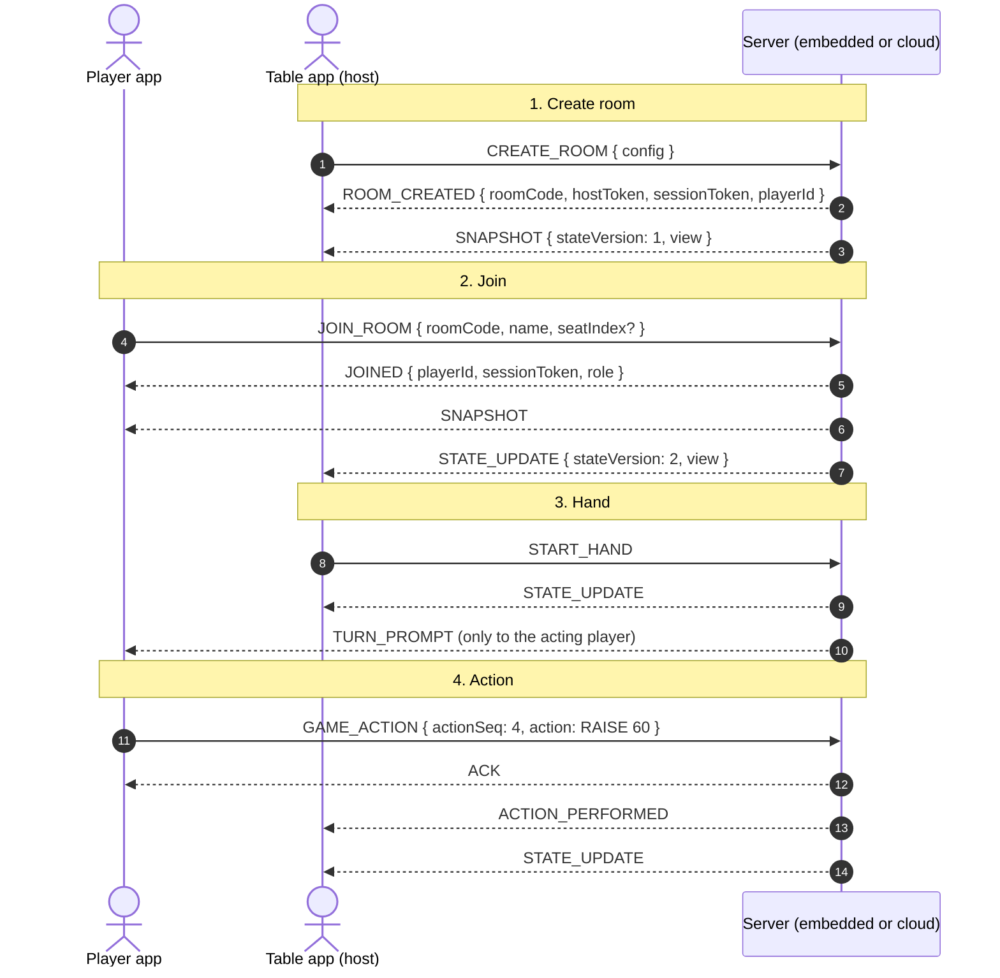

# API & Real-Time Protocol: Poker Credits

## 1. Overview

All clients (Table, Player, Spectator) talk to the authoritative Rust server over **one WebSocket** carrying JSON messages, plus a few plain HTTP endpoints. The same server code runs embedded in the host app (LAN) and as the standalone cloud binary. The host app's own UI connects over loopback with the same protocol.

- Transport: `GET /v1/ws` upgraded to WebSocket. `ws://` on LAN, `wss://` in the cloud.
- Encoding: UTF-8 JSON, max 16 KiB per message.
- Schema source of truth: Rust enums in `crates/poker_server_core/src/protocol.rs` (serde). Dart mirror in `packages/poker_protocol`. Golden examples in `protocol/fixtures/` are tested from both sides.
- Replaces: Socket.io events, Zod schemas, Express/Fastify REST routes of the old design.

### 1.1 Envelope

Every message, in both directions:

```json
{ "v": 1, "type": "GAME_ACTION", "reqId": "c-17", "...": "type-specific fields" }
```

| Field | Direction | Meaning |
| :--- | :--- | :--- |
| `v` | both | Protocol version, integer. Mismatch gives `VERSION_MISMATCH` error and close. |
| `type` | both | `SCREAMING_SNAKE_CASE` message name. |
| `reqId` | C2S optional, S2C echo | Client-chosen string. The server echoes it on the `ACK` or `ERROR` that answers that request. |

Rust shape (for implementers):

```rust
#[derive(Serialize, Deserialize)]
pub struct Envelope<T> { pub v: u16, #[serde(rename = "reqId", skip_serializing_if = "Option::is_none")] pub req_id: Option<String>, #[serde(flatten)] pub body: T }

#[derive(Serialize, Deserialize)]
#[serde(tag = "type", rename_all = "SCREAMING_SNAKE_CASE", rename_all_fields = "camelCase")]
pub enum ClientMessage { /* section 3 */ }

#[derive(Serialize, Deserialize)]
#[serde(tag = "type", rename_all = "SCREAMING_SNAKE_CASE", rename_all_fields = "camelCase")]
pub enum ServerMessage { /* section 4 */ }
```

Unknown fields are ignored on receive (forward compatibility). Unknown `type` yields `UNKNOWN_MESSAGE` and does not close the connection. Money values are non-negative integers (chips). No floats.

### 1.2 Roles

| Role | Created by | Can do |
| :--- | :--- | :--- |
| `HOST` | `CREATE_ROOM` | Everything a player can if seated, plus admin messages. Holds `hostToken`. |
| `PLAYER` | `JOIN_ROOM` with a seat | Act on own turn, request rebuy. |
| `SPECTATOR` | `JOIN_ROOM` with `spectator: true` | Read-only. |

The Table Display is a `HOST` (or a `SPECTATOR` in cloud mode when someone else hosts from a phone).

---

## 2. Sequence



---

## 3. Client → Server (`ClientMessage`)

### 3.1 `CREATE_ROOM`
```json
{ "v":1, "type":"CREATE_ROOM", "hostName":"Dimath",
  "config": { "startingChips":1000, "smallBlind":10, "bigBlind":20, "ante":0,
              "isTournament":false, "blindLevelMinutes":15, "turnTimeLimitSeconds":30 } }
```
Cloud mode only: a host-mode server answers `CREATE_ROOM` with `BAD_REQUEST`, so nobody else on the Wi-Fi can open rooms on the host's phone. In host mode the app creates the room through the bridge call `create_room(config)`, which returns `roomCode`, `playerId`, `sessionToken` and `hostToken`. The host UI then connects over loopback and sends `RESUME` with both `sessionToken` and `hostToken`, exactly like a reconnecting host.

### 3.2 `JOIN_ROOM`
```json
{ "v":1, "type":"JOIN_ROOM", "roomCode":"KQ7M", "name":"Alice", "seatIndex":1, "spectator":false }
```
Name rules: 1 to 20 chars, `[A-Za-z0-9 _-]`, trimmed. Room code: 4 chars from `ABCDEFGHJKLMNPQRSTUVWXYZ23456789`, case-insensitive on input, uppercased by the server.

### 3.3 `RESUME`
See section 5.
```json
{ "v":1, "type":"RESUME", "roomCode":"KQ7M", "sessionToken":"…", "lastStateVersion":42, "hostToken":"…optional…" }
```

### 3.4 `START_HAND` (host)
No extra fields. Deals the next hand from `LOBBY` or `NEXT_HAND_PREP`.

### 3.5 `GAME_ACTION` (player)
```json
{ "v":1, "type":"GAME_ACTION", "reqId":"c-17", "actionSeq":4,
  "action": { "kind":"RAISE", "toAmount":60 } }
```
`action.kind` is one of `FOLD`, `CHECK`, `CALL`, `RAISE` (needs `toAmount`), `ALL_IN`. `actionSeq` is the per-session action counter (section 5.3). The client sends the `nextActionSeq` it last received from the server; a repeated or older value is acknowledged but not applied.

### 3.6 `RESOLVE_SHOWDOWN` (host)
```json
{ "v":1, "type":"RESOLVE_SHOWDOWN",
  "allocations":[ { "potIndex":0, "winnerPlayerIds":["p_1","p_2"] }, { "potIndex":1, "winnerPlayerIds":["p_2"] } ] }
```

### 3.7 Host admin messages
`UNDO`, `PAUSE { reason? }`, `RESUME_GAME`, `APPROVE_REBUY { playerId, amount }`, `KICK { playerId }`, `ROOM_CONFIGURE { config }` (lobby only), `END_GAME`. All require the connection to be authenticated as `HOST`; otherwise `HOST_ONLY_ACTION`.

### 3.8 `REQUEST_REBUY` (player)
`{ "type":"REQUEST_REBUY", "amount":1000 }`. Applied only at `NEXT_HAND_PREP`; otherwise queued as `pendingRebuy` (see RC-005).

### 3.9 `PING`
`{ "type":"PING", "t": 1730000000000 }`. Server answers `PONG` with the same `t`. Clients send it after 15 s with no other outgoing message.

### 3.10 Additions in Phase 2 (additive, no version bump)
| Type | Sender | Body | Purpose |
| :--- | :--- | :--- | :--- |
| `BEGIN_SHOWDOWN` | host | none | Ends the `ALL_IN_RUNOUT` after the cards are dealt, moves to `SHOWDOWN`. |
| `SET_SITTING_OUT` | player | `sittingOut` | Skip or rejoin from the next hand. |
| `LEAVE_TABLE` | player | none | Fold now (if live) and sit out; the session stays valid. |
| `PRESENCE_VOTE` | player | `playerId, stillPlaying` | Answer a presence check (3.11). |
| `PRESENCE_ACK` | player | none | "I am still here": cancels a check about the sender. |

### 3.11 Presence check (inactive players)
See `RESILIENCE_AND_CRASH_HANDLING.md` 3.8. The server sends `PRESENCE_CHECK { subjectPlayerId, subjectName, deadlineMs }` to every seated player except the subject, and `PRESENCE_RESOLVED { subjectPlayerId, removed }` when it ends. The host's vote is final; otherwise a strict majority of the replies decides; silence abstains.

---

## 4. Server → Client (`ServerMessage`)

### 4.1 `ROOM_CREATED`, `JOINED`
```json
{ "v":1, "type":"JOINED", "reqId":"c-2", "playerId":"p_3", "role":"PLAYER", "seatIndex":1,
  "sessionToken":"…128-bit random…" }
```
`ROOM_CREATED` adds `roomCode` and `hostToken`. Clients store tokens in platform secure storage (see `SECURITY_AND_EDGE_CASES.md`).

### 4.2 `SNAPSHOT`
Full state view. Sent after `JOINED`, after every successful `RESUME`, and whenever the server decides a client must resync (for example after it was disconnected as a slow consumer).
```json
{ "v":1, "type":"SNAPSHOT", "stateVersion":42, "serverTime":1730000000000, "nextActionSeq":4, "view": { …RoomView… } }
```

### 4.3 `STATE_UPDATE`
Sent to all connections after each state change. In v1 this is always the **full public view**, not a delta (state is small: at most 10 seats). `stateVersion` increases by exactly 1 per change; a client that sees a gap sends `RESUME`.
```json
{ "v":1, "type":"STATE_UPDATE", "stateVersion":43, "view": { …RoomView… } }
```

`RoomView` (public, never contains private data):
```json
{
  "roomCode":"KQ7M", "handNumber":7,
  "phase":"FLOP",
  "dealerSeat":2, "smallBlindSeat":3, "bigBlindSeat":4, "activeSeat":5,
  "currentHighBet":60, "minRaiseTo":120, "totalPot":210,
  "pots":[ { "tierIndex":0, "amount":150, "eligiblePlayerIds":["p_1","p_2","p_3"] },
           { "tierIndex":1, "amount":60,  "eligiblePlayerIds":["p_2","p_3"] } ],
  "seats":[ { "seatIndex":0, "playerId":"p_1", "name":"Alice", "chips":940,
              "streetBet":60, "hasFolded":false, "isAllIn":false, "isSittingOut":false, "isConnected":true } ],
  "paused":false,
  "turnDeadlineMs":1730000030000,
  "spectatorCount":2
}
```
`phase` is one of: `LOBBY`, `PRE_FLOP`, `FLOP`, `TURN`, `RIVER`, `ALL_IN_RUNOUT`, `SHOWDOWN`, `NEXT_HAND_PREP`, `PAUSED`. `PAUSED` is shown while `paused` is true (the engine keeps the real phase). `STARTING_HAND`, `POSTING_BLINDS`, `HAND_WON_UNCONTESTED` and `PAYOUT` are transient inside one command and never appear. `minRaiseTo` is the smallest legal raise-to total for the next raise (current bet plus the last full raise increment), zero outside a betting street; the per-player cap is in `TURN_PROMPT.legal`. `turnDeadlineMs` is an absolute server time; clients compute the countdown locally using `serverTime` offset, so the old per-second `timer_tick` broadcast is not needed.

### 4.4 `TURN_PROMPT` (only to the acting player)
```json
{ "v":1, "type":"TURN_PROMPT", "playerId":"p_3", "seatIndex":5, "turnDeadlineMs":1730000030000, "nextActionSeq":4,
  "legal": { "canFold":true, "canCheck":false, "canCall":true, "callAmount":20,
             "canRaise":true, "minRaiseTo":40, "maxRaiseTo":940 } }
```
Triggers haptics and sound in the Player app.

### 4.5 `ACTION_PERFORMED`
Broadcast for the ticker and sound effects.
```json
{ "v":1, "type":"ACTION_PERFORMED", "playerId":"p_3", "playerName":"Charlie", "kind":"RAISE", "amount":60, "chipsRemaining":940, "allIn":false, "auto":false }
```
`auto` is true for timer-driven auto-check or auto-fold. `kind` is `FOLD`, `CHECK`, `CALL`, `BET` or `RAISE` (`BET` opens the betting). `amount` is the player's **street total after the action** ("raises to 60", "calls 60"), not the chips added. `allIn` is true when the action used the last chip.

### 4.6 `ACK` and `ERROR`
```json
{ "v":1, "type":"ACK", "reqId":"c-17", "nextActionSeq":5, "duplicate":false }
{ "v":1, "type":"ERROR", "reqId":"c-17", "code":"BELOW_MIN_RAISE", "message":"Minimum raise is to 40", "details": { "minRaiseTo":40 } }
```

### 4.7 Presence and control
| Type | Body | Sent when |
| :--- | :--- | :--- |
| `PLAYER_CONNECTION` | `seatIndex, playerId, isConnected` | A player disconnects or reconnects. |
| `GAME_PAUSED` | `pausedBy, reason?` | Host pauses. |
| `GAME_RESUMED` | `resumedBy, turnDeadlineMs` | Host resumes; deadline is extended by the paused duration. |
| `ROOM_RECOVERED` | `reason` | The room actor was restarted after a panic (see resilience doc). A `SNAPSHOT` follows. |
| `ROOM_CRASHED` | `reason` | Room frozen after repeated panics. |
| `ROOM_EXPIRED` | none | Room purged after 60 minutes idle, or closed by the host with `END_GAME`. Always delivered before the socket closes. |
| `PONG` | `t` | Answer to `PING`. |
| `PRIVATE_STATE` | reserved | Reserved for a future optional card-input mode. Never part of `RoomView`; sent to one connection only. |

---

## 5. Reconnect and Resume

Socket.io's automatic reconnection is gone, so this section is the contract.

### 5.1 Client behaviour
1. On socket loss, enter `reconnecting` and retry with the backoff in `RESILIENCE_AND_CRASH_HANDLING.md` section 4.1.
2. After the socket opens, the first message must be `RESUME` (stored `roomCode`, `sessionToken`, `lastStateVersion`, plus `hostToken` for the host).
3. Server verifies the token and replies with `SNAPSHOT`. The client **replaces its whole view**; it never tries to merge.
4. An action sent before the loss with no `ACK` seen is re-sent **only if** the snapshot shows it is still that player's turn and the snapshot's `nextActionSeq` equals the value the action used. Otherwise it was applied (or is stale) and is dropped.

### 5.2 Server behaviour
- Token valid and room alive: attach this connection to the seat, close any older connection for the same seat (code `SUPERSEDED`), broadcast `PLAYER_CONNECTION`, send `SNAPSHOT`.
- Token invalid or room gone: `ERROR INVALID_SESSION` or `ROOM_NOT_FOUND`, then close. Client clears stored tokens and returns to the join screen.
- If `RESUME` is not the first message after connect (and not `JOIN_ROOM`/`CREATE_ROOM`), reject with `NOT_AUTHENTICATED` and close. `PING` is the one exception: it is answered before joining so a client can test the link.
- The first message must arrive within 10 s of the upgrade, or the socket is closed.
- After `JOIN_ROOM`, errors the user can fix on the same socket (`NAME_INVALID`, `SEAT_OCCUPIED`, `ALREADY_SEATED`, `BAD_REQUEST`, `INVALID_AMOUNT`) leave it open for another try. All other refusals (`ROOM_NOT_FOUND`, `INVALID_SESSION`, `ROOM_FULL`, `ROOM_CRASHED`, `RATE_LIMITED`, ...) are followed by a close.
- Wrong room codes and tokens are counted **per IP address**, not per connection: 20 failed `JOIN_ROOM`/`RESUME` attempts within a minute block the address for 15 minutes (`RATE_LIMITED` and close). `CREATE_ROOM` is limited to 6 per minute per IP (burst 3). Successful joins are never counted.
- Every data frame, well-formed or not, costs one token of the connection's bucket (10 per second, burst 20; three refusals close the socket). Only well-formed requests and WebSocket ping/pong frames reset the 45 s idle timer.

### 5.3 `actionSeq` rules
- The counter is **monotonic per session** (not reset per hand), so the client never needs a "new hand" signal. The server stores `nextActionSeq: u64`, initial value 0 when the session is created.
- Apply the action iff `actionSeq == nextActionSeq`; after a successful apply, `nextActionSeq += 1`. **Only applied actions advance it.** A rejected action (an `ERROR` such as `BELOW_MIN_RAISE`) does not, so the client retries with the same value.
- `actionSeq < nextActionSeq`: duplicate (a retry of something already applied). Answer `ACK` with `duplicate:true` and do nothing, so the client can stop retrying.
- `actionSeq > nextActionSeq`: `ERROR OUT_OF_SYNC`; the client sends `RESUME` to resync.
- The server tells the client the current value in `ACK.nextActionSeq`, `TURN_PROMPT.nextActionSeq` and `SNAPSHOT.nextActionSeq`. The client always overwrites its own counter with the latest server value; it never increments locally on its own.
- The counter is persisted in snapshots and rebuilt by journal replay (each journal entry records the `actionSeq` it consumed).

---

## 6. Error codes

| Code | Meaning | UI handling |
| :--- | :--- | :--- |
| `VERSION_MISMATCH` | Protocol `v` not supported. | "Update the app" screen. |
| `UNKNOWN_MESSAGE` | Unknown `type`. | Log only. |
| `BAD_REQUEST` | JSON invalid or field out of range. | Log; show generic error. |
| `NOT_AUTHENTICATED` | First message was not join/create/resume. | Reconnect flow. |
| `INVALID_SESSION` | Token missing, expired or wrong. | Clear stored tokens; re-join. |
| `ROOM_NOT_FOUND` | Room code does not exist. | Back to join screen with toast. |
| `ROOM_FULL` | 10 players seated. | Offer spectator join. |
| `SPECTATORS_FULL` | 20 spectators. | Toast. |
| `SEAT_OCCUPIED` | Seat taken. | Highlight next free seat. |
| `NAME_INVALID` | Name fails validation. | Inline field error. |
| `NOT_YOUR_TURN` | Action out of turn. | Disable buttons; banner. |
| `INVALID_CHECK` | Check not legal. | Swap "Check" for "Call X". |
| `BELOW_MIN_RAISE` | Raise too small. | Snap slider to minimum (`details.minRaiseTo`). |
| `INSUFFICIENT_FUNDS` | More than stack. | Cap at all-in. |
| `OUT_OF_SYNC` | `actionSeq` gap. | Send `RESUME`. |
| `HOST_ONLY_ACTION` | Non-host used admin message. | Toast; hide admin controls. |
| `HAND_NOT_IN_PROGRESS` | No active hand. | Refresh from snapshot. |
| `HAND_IN_PROGRESS` | `START_HAND` during a hand (also covers a double tap, RC-004). | Ignore. |
| `GAME_PAUSED` | Action while paused. | "Paused" overlay. |
| `RATE_LIMITED` | Too many messages. | Back off. Connection closes after 3 strikes. |
| `SUPERSEDED` | Same seat connected elsewhere. | Show "Opened on another device". |
| `ROOM_CRASHED` | Room frozen after repeated server panics. | Show support message, offer leave. |
| `ALREADY_SEATED` | Player already has a seat. | Ignore. |
| `INVALID_ACTION` | Action makes no sense now (call with nothing to call). | Refresh from snapshot. |
| `BETTING_NOT_REOPENED` | Raise after a short all-in that did not reopen betting. | Show Call / Fold only. |
| `INVALID_AMOUNT` | Amount zero, above the stack limit or over the table cap. | Inline field error. |
| `NOT_PAUSED` | Resume while not paused. | Ignore. |
| `NOT_ENOUGH_PLAYERS` | Fewer than two players can be dealt in. | "Waiting for players". |
| `UNKNOWN_PLAYER` | No such player. | Refresh from snapshot. |
| `NOTHING_TO_UNDO` | Undo history empty. | Toast. |
| `INVALID_ALLOCATION` | Showdown winners rejected (missing pot, ineligible winner). | Re-open the picker. |
| `ILLEGAL_STATE` | Command not allowed in this phase. | Refresh from snapshot. |
| `NO_PRESENCE_CHECK` | Vote for a player with no running check. | Ignore. |
| `INTERNAL_ERROR` | Unexpected server fault. | Generic error; report. |

Engine errors map to codes through one `impl From<&PokerError> for ErrorCode` in `protocol.rs`; the mapping is exhaustive (no wildcard arm). `BELOW_MIN_RAISE` carries `details.minRaiseTo`, `INSUFFICIENT_FUNDS` carries `details.maxTo`, and `INVALID_CHECK` carries `details.callAmount` (added by the room).

---

## 7. HTTP endpoints

All under the same axum router as the WebSocket.

`GET /v1/ws` answers `429` (no upgrade) when the client address already holds 40 connections.

### `GET /health`
```json
{ "status":"healthy", "activeRooms":3, "version":"0.1.0", "protocol":1 }
```

### `GET /v1/info`
Used by the join screen after scanning a QR code or typing an address, before opening the socket. Works in both modes. `mode` is `HOST` (embedded in the host's app) or `CLOUD` (standalone binary).
```json
{ "protocol":1, "mode":"HOST", "serverName":"Dimath's tablet", "roomCount":1 }
```
Room codes are never listed, in either mode: a player needs the code from the QR payload or from the host. `roomCount` is for the UI only.

### `GET /v1/room/{code}`
```json
{ "exists":true, "playerCount":3, "maxPlayers":10, "isFull":false, "inProgress":true }
```
An unknown or frozen room answers `200` with `exists:false` and zeros. Rate limited per IP (default 2 per second, burst 10; `429` beyond that). Room codes are guessable (32^4 ≈ 1M), see security doc 6.6 for the matching limits on the WebSocket.

### `GET /` and static assets (later, Phase 7)
When `POKER_WEB_DIR` is set (cloud) or web assets are embedded (host mode), the server serves the built Flutter web player at `/`. The web client opens `ws(s)://<same host>/v1/ws` derived from its own URL. No protocol change. Chips and timestamps stay below 2^53-1 so JavaScript clients are exact (ADR-014).

`GET /api/lan/info` from the old design is dropped: the host app learns its own addresses from the OS (`NetworkInterface.list()`), not from the server.

---

## 8. Versioning and compatibility

- `v` is an integer, currently `1`. Additive changes (new optional fields, new message types) do **not** bump `v`.
- A bump is needed for removed or re-typed fields or changed semantics. During a bump the server supports `v` and `v-1` for one release.
- The `/v1/` path prefix is for HTTP and WebSocket route versioning; the `v` field is for message semantics. They move together at major changes.
- Every `v` has fixtures in `protocol/fixtures/v1/`. CI fails if a fixture no longer round-trips in Rust or Dart.
- Protocol version is also in the QR payload (`v=1`) so an old app can say "update" before connecting.
