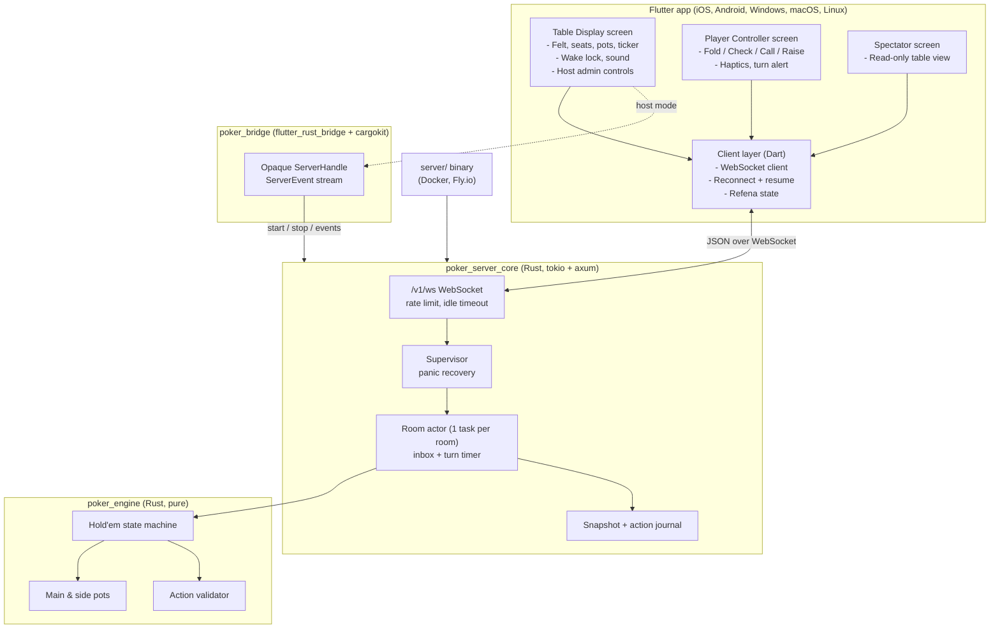
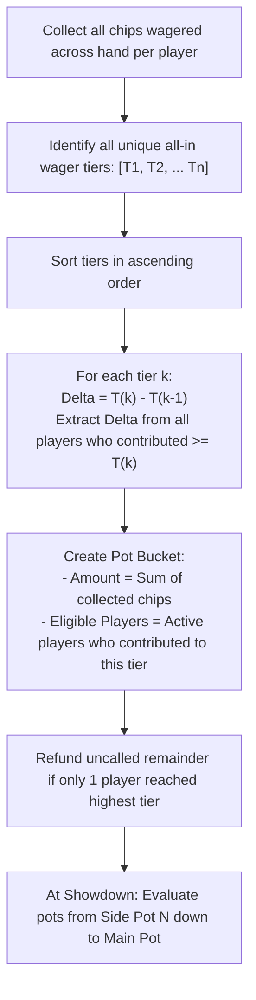
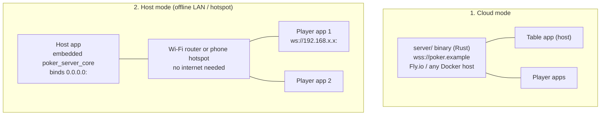
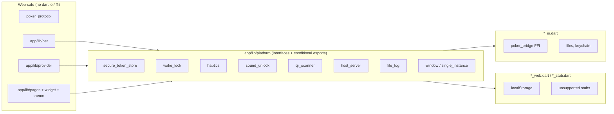
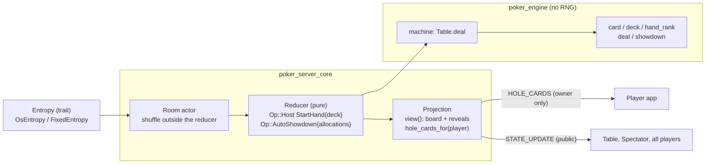

# Architecture & System Design: Poker Credits

> Stack pivot 2026-11-01: Flutter client + Rust server/engine. See `DECISIONS.md` ADR-008 to ADR-012. Sections 4 and 5 (state machine, pot algorithm) are language-independent and unchanged.

## 1. Executive Summary

**Poker Credits** is a real-time, multi-device companion application for in-person Texas Hold'em games. It replaces physical chips with a digital credit, pot and betting system while players handle physical cards in real life.

Two screen paradigms in one Flutter app:
1. **Table Display** (tablet, laptop, TV, or a phone in a stand): active pot, side pots, radial seating, dealer button, turn countdown, action ticker, host admin controls.
2. **Player Controller** (phone): one-handed fold, check, call, raise with haptics.

The backend is an **authoritative Rust game server** that runs either in the cloud or **embedded inside the host's app** for offline LAN play. Same code, same protocol.

---

## 2. High-Level System Architecture

Dependency direction: `app` → `poker_bridge` → `poker_server_core` → `poker_engine`; `server/` → `poker_server_core`. The Dart WebSocket client does not use FRB: it is a plain socket client so one code path serves loopback (host), LAN and cloud.

---

## 3. Core Subsystems & Components

### 3.1 Poker engine (`crates/poker_engine`)
Pure Rust: no async, no I/O, no clock, no RNG, no global state.
- `apply(&GameState, Command) -> Result<Transition, PokerError>` where `Transition { state, events }`. The old state is never mutated.
- Guarantees: no illegal action is accepted; chip total is conserved; given the same snapshot and command list the result is bit-identical (this is what makes journal replay exact).
- Modules: `types` (newtypes `Chips`, `PlayerId`, `SeatIndex`), `state`, `command`, `event`, `error`, `validator`, `pots`, `blinds` (strategy trait; `CashGame`, `Tournament`), `button` (dead button, heads-up), `machine` (transition table).
- Default features only; `cargo test` works in the crate directory with no flags.

### 3.2 Server core (`crates/poker_server_core`)
- `start(ServerConfig) -> ServerHandle` binds axum, serves `/v1/ws`, `/health`, `/v1/info`, `/v1/room/{code}`, `/v1/lobbies`.
- **Room actor**: one tokio task per room owns the state; processes inbox messages and the turn-timer deadline in a single `select!` loop (see `RESILIENCE_AND_CRASH_HANDLING.md` 3.2).
- **Supervisor**: restarts a panicked room from snapshot + journal.
- **Sessions**: random 128-bit tokens, constant-time compare, stored hashed in the snapshot.
- **Store**: atomic snapshot writes plus write-ahead journal.
- **Events**: `ServerEvent` enum over a channel, consumed by the bridge (host mode) or logged (cloud mode).

### 3.3 Bridge (`packages/poker_bridge`)
Layout mirrors LocalSend's `packages/localsend_isolates`: `rust/` is the plugin crate, `rust_builder/` holds cargokit, `lib/` is the Dart facade. The app imports only this package. API: `startServer(config)`, `stopServer()`, `createRoom(config)`, `serverEvents()` stream, `localAddresses()`, `enableDebugLogging()`. Code generation: `flutter_rust_bridge_codegen generate` from the package directory.

### 3.4 Flutter app (`app/`)
- Layers: `config/` (init, error app, error hooks), `theme/` (tokens, `BrutalTheme`), `model/`, `provider/` (Refena), `net/` (socket client, reconnect), `pages/` (table, player, spectator, join, settings), `widget/brutal/` (design-system widgets) and `widget/table|player/`, `platform/` (the only place with platform-specific code, see section 9), `util/`.
- Visual language: neo-brutalism, `docs/UI_DESIGN.md`.
- **The client never computes game outcomes.** It renders `RoomView` and sends intents. A local legal-action preview for button enabling is allowed only from the server-provided `TURN_PROMPT.legal`.
- Host-mode flow: start server through the bridge, create the room, connect to `ws://127.0.0.1:<port>/v1/ws` as `HOST`, show the QR code.

### 3.5 Concurrency model
- UI isolate: rendering and light JSON handling only.
- Rust runs on its own tokio runtime threads, so the embedded server never blocks the UI isolate. LocalSend uses additional Dart child isolates because it also runs Dart HTTP clients; we have no such workload, so we start without child isolates. If profiling shows JSON decode jank on low-end phones, move the socket client into a typed isolate (LocalSend's `typed_isolates` package is the model).
- Rule inherited from LocalSend: push settings the server needs (port, name, limits) **before** starting it.

---

## 4. Texas Hold'em State Machine

> **Note**: `PAUSED` is a host-only state accessible from any active betting street. When the host pauses the game (e.g. to resolve a dispute or take a break), no player actions are accepted. The host resumes by unpausing, restoring the exact state and turn clock as it was before.

```mermaid
stateDiagram-v2
    [*] --> LOBBY: Players join & configure buy-ins
    LOBBY --> STARTING_HAND: Host clicks "Deal Hand"

    STARTING_HAND --> POSTING_BLINDS: Advance Dealer (D) button
    POSTING_BLINDS --> PRE_FLOP: Deduct SB & BB, prompt UTG

    PRE_FLOP --> FLOP: All bets matched
    FLOP --> TURN: All bets matched
    TURN --> RIVER: All bets matched
    RIVER --> SHOWDOWN: All bets matched

    PRE_FLOP --> ALL_IN_RUNOUT: All remaining players are All-In
    FLOP --> ALL_IN_RUNOUT: All remaining players are All-In
    TURN --> ALL_IN_RUNOUT: All remaining players are All-In
    ALL_IN_RUNOUT --> SHOWDOWN: Board cards dealt IRL; no more betting

    PRE_FLOP --> HAND_WON_UNCONTESTED: All players fold except one
    FLOP --> HAND_WON_UNCONTESTED: All players fold except one
    TURN --> HAND_WON_UNCONTESTED: All players fold except one
    RIVER --> HAND_WON_UNCONTESTED: All players fold except one

    PRE_FLOP --> PAUSED: Host pauses game
    FLOP --> PAUSED: Host pauses game
    TURN --> PAUSED: Host pauses game
    RIVER --> PAUSED: Host pauses game
    PAUSED --> PRE_FLOP: Host resumes (was PRE_FLOP)
    PAUSED --> FLOP: Host resumes (was FLOP)
    PAUSED --> TURN: Host resumes (was TURN)
    PAUSED --> RIVER: Host resumes (was RIVER)

    SHOWDOWN --> PAYOUT: Host/Players mark winners for Main & Side Pots
    HAND_WON_UNCONTESTED --> PAYOUT: Pot awarded automatically to survivor

    PAYOUT --> NEXT_HAND_PREP: Chip stacks updated, bustouts flagged
    NEXT_HAND_PREP --> STARTING_HAND: Ready for next hand
    NEXT_HAND_PREP --> LOBBY: All but one player busted (game over)
```

### 4.1. Street Transition Invariants
A betting round (street) concludes if and only if:
1. Every active (non-folded, non-all-in) player has contributed an equal amount of chips to the current street.
2. Every active player has had at least one opportunity to act.
3. Or all active players except one have folded → `HAND_WON_UNCONTESTED`.
4. Or all remaining non-folded players are all-in → `ALL_IN_RUNOUT` (fast-forward to Showdown, board cards still dealt IRL).

### 4.2. Client Role Types
Three client roles connect to the same room (wire names in `API_AND_EVENTS.md` section 1.2):

| Role | Screen | Capabilities |
| :--- | :--- | :--- |
| `HOST` | Table screen | Full admin: start hand, undo, pause, approve rebuys, resolve showdown |
| `PLAYER` | Player screen | Act on turn (fold/check/call/raise), request rebuy |
| `SPECTATOR` | Spectator screen | Read-only table view, no actions, no seat |

---

## 5. Main Pot & Side Pot Algorithm

Multi-way all-ins with unequal stacks are notoriously difficult to calculate manually at home games. The engine automates this using **Contribution-Tier Partitioning**:

### Mathematical Example:
* **Player A** is All-In for **$50**
* **Player B** is All-In for **$120**
* **Player C** Calls **$120**
* **Player D** Folds after contributing **$20**

**Tiers**: $20 (folded), $50 (All-in A), $120 (All-in B, Call C).
1. **Tier 1 (Main Pot)**: Up to $50 per player.
   * Player A ($50) + Player B ($50) + Player C ($50) + Player D ($20) = **$170**.
   * Eligible to win: **A, B, C**.
2. **Tier 2 (Side Pot 1)**: From $50 to $120 ($70 delta).
   * Player B ($70) + Player C ($70) = **$140**.
   * Eligible to win: **B, C**.

At showdown:
* Side Pot 1 ($140) is awarded to the best hand between **B and C**.
* Main Pot ($170) is awarded to the best hand among **A, B, and C**.

---

## 6. Dual-Mode Network Topology

### 6.1 Host mode workflow
1. Host taps "Host a game". The app starts the embedded server on the configured port (default 7878, fallback to a random free port, then show the chosen one).
2. The app reads its own non-loopback IPv4 addresses (`NetworkInterface.list()`), picks the first private-range address, offers a picker if several.
3. The Table screen shows a QR code `pokercredits://join?h=192.168.43.1:7878&r=KQ7M&v=1` plus the typed fallback "IP + room code".
4. Players scan (in-app scanner) or type the details. The join screen calls `GET /v1/info` to validate the address before opening the socket.
5. Later (Phase 6, optional): UDP multicast announce so players see nearby hosts without scanning (ADR-012).

### 6.2 Cloud mode workflow
Players enter the server URL once (default baked in at build time) and a 4-letter room code. Room codes use the unambiguous alphabet `ABCDEFGHJKLMNPQRSTUVWXYZ23456789`.

---

## 7. Platform Integrations

| Capability | Plugin / API (to be confirmed in Phase 0) | Screen | Fallback |
| :--- | :--- | :--- | :--- |
| Keep screen awake | `wakelock_plus` | Table (always), Player (while in room) | No-op where unsupported |
| Haptics on your turn | `HapticFeedback.heavyImpact()` pattern; plugin only if a richer pattern is needed | Player | Sound + visual pulse (desktop has no haptics) |
| Sound effects | Audio plugin (chip clink, check knock, all-in, showdown) | Table, Player | Mute toggle |
| QR render | `pretty_qr_code` (used by LocalSend) | Table | Typed address |
| QR scan | Camera-based scanner plugin | Player | Typed address |
| Window management | `window_manager` (desktop) | Table | n/a |
| Secure token storage | Platform keychain/keystore plugin | All | In-memory only, re-join on restart |
| Background hosting | Android foreground service (own channel like LocalSend `foreground_service.dart`) | Host | Foreground only |
| Share/open invite link | `share_plus` or clipboard | Table | Copy to clipboard |

---

## 8. Platform Build Matrix & Required Configuration

| Platform | Needs | Notes |
| :--- | :--- | :--- |
| Android | `INTERNET`, `ACCESS_NETWORK_STATE`, `CAMERA`, `FOREGROUND_SERVICE` (+ type), `POST_NOTIFICATIONS`, `WAKE_LOCK`; no cleartext exception expected for `dart:io`/Rust sockets (ADR-012), verify on device in Phase 5 | Rust built by cargokit for `arm64-v8a`, `armeabi-v7a`, `x86_64` |
| iOS | `NSCameraUsageDescription`, `NSLocalNetworkUsageDescription` (both added in Phase 0); multicast entitlement only for Phase 6 and needs Apple approval (verify) | Sockets die on suspend: probe on resume |
| Windows | Firewall prompt on first listen (explain on host screen) | Inno Setup or MSIX packaging later |
| macOS | App Sandbox entitlements `network.server` and `network.client`, camera | |
| Linux | None special | Wayland/X11 differences handled by `window_manager` |
| Web (later, ADR-014) | Static hosting by the server; HTTPS for camera | Player and Spectator only; CI builds it from Phase 0 |

Toolchains: Flutter from `.fvmrc`, Rust from `rust-toolchain.toml`, both copied from LocalSend's pins at scaffold time and then owned by this repo.

---

## 9. Web Readiness (ADR-014)

Web is built later but the code must compile for it today.

| Seam | Native | Web |
| :--- | :--- | :--- |
| `host_server` (start embedded server) | FRB bridge | Stub: `isSupported == false`; Host screen hidden |
| `secure_token_store` | Keychain / Keystore | `localStorage`, player token only |
| `file_log` | Rotating file | Console only, in-memory ring buffer for "Copy diagnostics" |
| `wake_lock` | `wakelock_plus` | `wakelock_plus` (Screen Wake Lock API where available) |
| `haptics` | `HapticFeedback` | `navigator.vibrate` where available, otherwise no-op |
| `sound_unlock` | no-op | Resume audio context on first tap |
| `qr_scanner` | Camera plugin | Camera plugin if HTTPS, otherwise typed fallback |
| `server_address` | `NetworkInterface.list()` | `Uri.base` |
| `window`, `single_instance` | `window_manager`, handover | no-op |

Server side for web: static file serving of the built player, same-origin `Origin` acceptance, `Content-Type` and cache headers for the bundle. All additive; no protocol change.

Enforcement: `tool/check_web_safe.sh` fails CI if banned imports appear outside `app/lib/platform/*_io.dart`, and CI builds `fvm flutter build web` for the app.

---

## 10. Virtual cards mode (ADR-016)

A room is `PHYSICAL` (the default) or `VIRTUAL`. Virtual rooms add cards without touching the dependency direction (`app` → `poker_bridge` → `poker_server_core` → `poker_engine`):

Randomness is an input recorded in the journal, never re-derived on replay. The player phone shows board, pot and opponents itself, so the same room works over the internet with no shared screen.

Where things live:

| Piece | File |
| :--- | :--- |
| Cards, deck, ranking, `Table.deal`, `StartHand { deck }` | `crates/poker_engine` |
| `Entropy` strategy (`OsEntropy`, `FixedEntropy`), `Deps { clock, entropy }`, shuffle in the actor | `crates/poker_server_core/src/cards.rs`, `room/actor.rs` |
| Journaled ops (`HostCommand::StartHand { deck }`, `Op::AutoShowdown`), `hand_names` | `room/state.rs`, `room/ops.rs` |
| Per-recipient projection (`hole_cards_for`, `view()` with board, reveals, result) | `room/cards.rs`, `room/view.rs` |
| `UPDATE_REQUIRED` gate | `net/ws.rs` |
| Files readable by the owner only (`0600` / `0700`) | `store/private.rs` |
| Wire types | `protocol.rs`, `packages/poker_protocol` |
| Card widgets, tokens, settings | `app/lib/widget/cards/`, `theme/tokens.dart`, `model/app_settings.dart` |
| Hole cards in client state, `showsCards`, `RunoutPacer` | `app/lib/model/` |

The Dart app holds no poker rule: it draws what the server sent (the cards, the categories and the winners all come from the engine). Details: `docs/superpowers/specs/2026-11-07-virtual-cards-design.md`.

## 11. Single player with bots (ADR-018, proposed, not built)

Spec: `docs/superpowers/specs/2026-11-07-single-player-bots-design.md`. A solo game is the host topology (section 6) with the server bound to `127.0.0.1` and no network client. New pieces:
- `crates/poker_bots`: pure strategy (`BotView` in, `Decision {action, think_ms}` out), personalities, opponent notes, a small PRNG. Depends on `poker_engine` types only.
- `crates/poker_server_core/src/room/bots.rs`: builds a `BotView` for one seat, owns each bot's `BotMind`, schedules bot actions. The actor adds the earliest bot due time to `next_wake_ms` and `run_due` submits the bot's `Op::Action` like it submits `Op::Timeout`. Illegal or failed decisions fall back to check or fold.
- Bots are `Player`s with `is_bot` and no connection; `Absence` and vote-kick skip them. `Op::AddBot` journals a bot with its personality; decisions are journaled as normal actions, so replay never reruns bot logic.
- Idle cost is zero: the actor sleeps between timers. The Flutter lifecycle pauses the room in the background.
