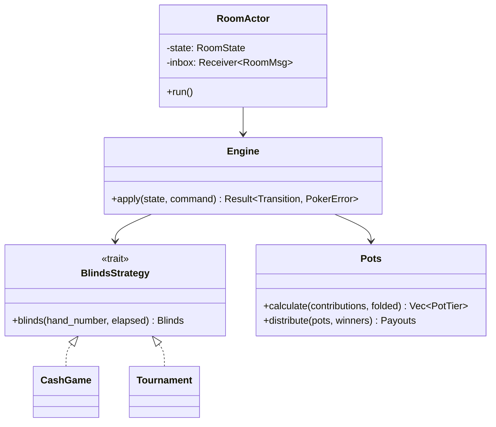
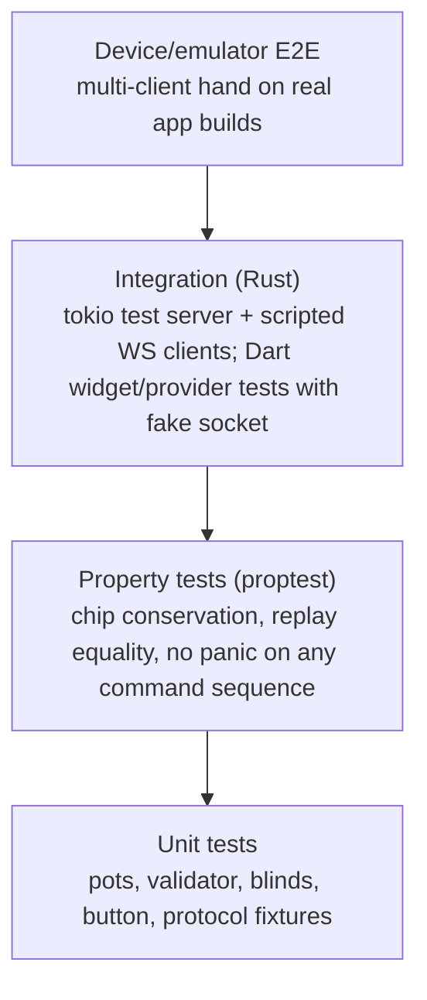

# Coding Standards, Design Patterns & Quality Guidelines

Languages: **Rust** (engine, server core, cloud binary, bridge crate) and **Dart/Flutter** (app, protocol models, bridge facade). Tooling conventions follow LocalSend (`~/Documents/dev_projects/localsend/AGENTS.md`) where noted.

## 1. Core Engineering Principles

### 1.1 SOLID
* **SRP**: `pots` only computes chips; it does not rank hands or touch sockets. A Dart widget renders; it does not decide game outcomes.
* **OCP**: blind schedules are a `BlindsStrategy` trait; adding a variant does not change the state machine.
* **LSP / DIP**: the engine depends on nothing but `std`, `serde`, `thiserror`. The server depends on engine traits, never the reverse. Tests substitute fake transports.
* **ISP**: Table, Player and Spectator screens each get a narrow provider interface (`TableViewModel`, `PlayerViewModel`, `SpectatorViewModel`); the Table never receives private action dispatchers.

### 1.2 KISS, DRY, YAGNI
* Rules live once, in `poker_engine`. The Dart side holds no poker rules.
* The wire format is defined once in Rust; Dart mirrors it and is checked by golden fixtures.
* No database, no ORM, no auth provider, no extra isolates until measured need.

---

## 2. Design Patterns



* **Pure reducer / state machine**: `apply(&State, Command) -> Result<Transition, PokerError>`. Transition table is data (`fn allowed(from, to) -> bool`), not scattered `if` chains. Illegal transitions return `PokerError::IllegalTransition`.
* **Command**: every player or admin intent is an enum variant of `Command` carrying `player_id`. Undo and journal both operate on commands.
* **Strategy**: blinds (cash vs tournament).
* **Actor**: one task per room; message passing, no shared mutable game state.
* **Observer via events**: the engine returns `Vec<Event>` in the `Transition`; the server maps events to wire messages. The engine knows nothing about WebSockets.
* **Factory**: `RoomCode::generate(&mut impl CryptoRng)` and `SessionToken::generate()` live in the server crate (engine has no RNG). Alphabet `ABCDEFGHJKLMNPQRSTUVWXYZ23456789`; tokens are 128 random bits from the OS RNG.
* **Drop guards**: any reservation made before an `.await` is released by a guard (`RESILIENCE_AND_CRASH_HANDLING.md` 3.5).

---

## 3. Rust Standards

### 3.1 Toolchain and layout
* Toolchain pinned in `rust-toolchain.toml` with `clippy` and `rustfmt` components. Edition 2024 and resolver 3 (LocalSend uses resolver 3 at the workspace root; its member crates mix editions 2021 and 2024, we use 2024 everywhere).
* Root `Cargo.toml` is a workspace with a single `Cargo.lock`; profiles only in the root.
* File names: `snake_case.rs`. Module per concept, no `mod.rs` files in new code (use `foo.rs` + `foo/`).
* Crate features: `poker_engine` has none required. A bare `cargo test -p poker_engine` must pass. Optional features in `poker_server_core` (for example `discovery`) must also build with `--no-default-features`.

### 3.2 Lints (workspace-level)
```toml
[workspace.lints.rust]
unsafe_code = "forbid"          # bridge crate may relax with justification
missing_docs = "warn"

[workspace.lints.clippy]
pedantic = { level = "warn", priority = -1 }
unwrap_used = "deny"
expect_used = "deny"
indexing_slicing = "deny"
panic = "deny"
todo = "deny"
dbg_macro = "deny"
```
Tests may `#![allow(clippy::unwrap_used, clippy::expect_used, clippy::indexing_slicing)]`.

### 3.3 Domain types
Newtypes prevent mixing money, seats and ids:
```rust
#[derive(Clone, Copy, Debug, PartialEq, Eq, PartialOrd, Ord, Hash, Serialize, Deserialize)]
#[serde(transparent)]
pub struct Chips(u64);
impl Chips {
    pub const ZERO: Chips = Chips(0);
    pub fn checked_add(self, o: Chips) -> Option<Chips> { self.0.checked_add(o.0).map(Chips) }
    pub fn checked_sub(self, o: Chips) -> Option<Chips> { self.0.checked_sub(o.0).map(Chips) }
}
#[derive(Clone, Debug, PartialEq, Eq, Hash, Serialize, Deserialize)] #[serde(transparent)] pub struct PlayerId(String);
#[derive(Clone, Copy, Debug, PartialEq, Eq, Hash, Serialize, Deserialize)] #[serde(transparent)] pub struct SeatIndex(u8);
```
* All arithmetic on chips is checked; overflow returns `PokerError::Overflow`.
* Odd-chip distribution rule from `GAME_LOGIC_AND_RULES.md` is implemented in one function and unit-tested.

### 3.4 Actions as enums
```rust
#[derive(Clone, Debug, PartialEq, Eq, Serialize, Deserialize)]
#[serde(tag = "kind", rename_all = "SCREAMING_SNAKE_CASE", rename_all_fields = "camelCase")]
pub enum PlayerAction { Fold, Check, Call, Raise { to_amount: Chips }, AllIn }
```
Match exhaustively; no wildcard arms on domain enums.

### 3.5 Errors
* Library crates: `thiserror` enums (`PokerError`, `ProtocolError`, `StoreError`). Binary and bridge edges may use `anyhow`.
* Anticipated domain failures are values (`Result`), never panics.
* Error to wire code mapping is one exhaustive `match`.

### 3.6 Async rules (server core)
* Never hold a `std::sync::Mutex` guard across `.await`. Prefer actors over locks.
* Every spawned task has an owner that observes its `JoinHandle`.
* All channels are bounded; the policy on full is documented at the creation site.
* All network reads have a timeout; all outbound writes go through the connection's bounded queue.
* No blocking I/O on the runtime: file writes in snapshot code use `tokio::fs` or `spawn_blocking`.

### 3.7 Commands
```bash
cargo fmt --all --check
cargo clippy --workspace --all-targets -- -D warnings
cargo test --workspace
```

---

## 4. Dart / Flutter Standards

### 4.1 Toolchain
* Always `fvm flutter` and `fvm dart`, never bare binaries (same rule as LocalSend).
* Pub workspace at the repo root (members: `app`, `packages/poker_bridge`, `packages/poker_protocol`), one `pubspec.lock`.
* Formatting width **150** (`page_width: 150`, `trailing_commas: preserve`) in `analysis_options.yaml`, matching LocalSend.
* Lints: `flutter_lints` plus `strict-casts`, `strict-inference`, `strict-raw-types`.

### 4.2 Files and naming
* Files and folders: `snake_case`. Types: `PascalCase`. Members: `lowerCamelCase`. Constants: `lowerCamelCase` (Dart convention), not `UPPER_SNAKE`.
* Widgets: one public widget per file, file named after the widget (`pot_display.dart`).
* No barrel files except package entry points.

### 4.3 State management
* Refena (`refena_flutter`) as in LocalSend: `NotifierProvider` for plain state, `ReduxProvider` with action classes for anything that talks to the socket or the bridge.
* Models: `dart_mappable` (`@MappableClass`). In this repo `fromJson`/`toJson` are Map converters, as configured in LocalSend's `build.yaml`.
* Providers never import widgets. Widgets never open sockets.

### 4.4 Presentational vs container
* **Presentational widgets**: stateless, data in, callbacks out (`ChipStack`, `PotCounter`, `SeatChip`, `RaiseSlider`).
* **Screens**: read providers, own screen-local state, no business rules.
* **Services** (`SocketClient`, `ReconnectController`, `SecureTokenStore`): plain Dart classes behind interfaces so tests can fake them.

### 4.5 Theming and accessibility
* Visual language is neo-brutalism (ADR-013). Tokens, components and screens are specified in `docs/UI_DESIGN.md`. All values come from `app/lib/theme/tokens.dart`; no hex colours or magic sizes in widgets.
* Use the `widget/brutal/` components; do not use stock Material buttons, cards or dialogs for visible UI.
* Semantics labels on every action button; minimum 48x48 tap targets (56x56 for Player action buttons); never rely on colour alone.

### 4.6 Animation
* Never block input or delay a state update for an animation. Motion tokens: 80 ms, 150 ms, max 300 ms; snappy, no springs or bounce. Respect "reduce motion" platform settings (durations to 0).

### 4.7 Errors
* Global hooks per `RESILIENCE_AND_CRASH_HANDLING.md` 2.2. Never `catch (_) {}`; always log with stack trace.
* Socket errors are values on a state stream (`ConnectionState.reconnecting`, `.failed(reason)`), not thrown into the widget tree.

### 4.8 Web-safe rules (ADR-014)
* Outside `app/lib/platform/*_io.dart` and `packages/poker_bridge`: no `dart:io`, no `dart:ffi`, no `dart:html`/`package:web`, no `Platform.isX`. Use `defaultTargetPlatform` and `kIsWeb` only inside `app/lib/platform/` factories.
* Platform-specific behaviour goes behind an interface in `app/lib/platform/` with conditional exports: `export 'x_stub.dart' if (dart.library.io) 'x_io.dart' if (dart.library.js_interop) 'x_web.dart';`.
* `packages/poker_protocol` is pure Dart. `app/lib` never imports `poker_bridge` outside `platform/host_server_io.dart`.
* Numbers on the wire stay below 2^53-1. 64-bit identifiers travel as strings.
* No runtime downloads of assets (fonts, wasm); everything is bundled.
* Check: `tool/check_web_safe.sh`, and `fvm flutter build web` in CI.

### 4.9 Commands
```bash
fvm flutter pub get
fvm dart run build_runner build          # dart_mappable
fvm dart format --set-exit-if-changed lib test
fvm flutter analyze
fvm flutter test
flutter_rust_bridge_codegen generate     # from packages/poker_bridge
```

---

## 5. API & Validation Standards

* **Rust is the schema.** Deserialising into `ClientMessage` with serde is the first validation layer; unknown fields are ignored, unknown variants map to `UNKNOWN_MESSAGE`.
* **Second layer** is semantic validation in a `validate()` per message (name charset and length, seat range 0..=9, amounts non-zero where required). Return `BAD_REQUEST` or the specific code.
* **Third layer** is the engine's rules (turn order, legal action, min raise). The engine never assumes the previous layers ran.
* Dart side: parse server messages with generated mappers; on parse failure log and ignore the message (never crash the UI); count failures and show "Protocol error" after 5 in a row.
* Wire contract and fixtures: `API_AND_EVENTS.md`, `protocol/fixtures/`.

---

## 6. Testing Strategy



### 6.1 Engine priorities (aim for 100% branch coverage on `pots`, `validator`, `button`)
* Heads-up all-in with unequal stacks; 3-way and 4-way all-ins with several tiers.
* Split pot with odd chips ($101 between two players: $51 to the player closest left of the button, $50 to the other).
* Min-raise enforcement; incomplete (short) all-in does not reopen betting.
* Check when facing a bet returns `PokerError::CannotCheck`.
* Dead button, dead small blind, heads-up transition, simultaneous knockouts.
* **Property tests**: (1) sum of stacks plus pots is invariant over any legal sequence; (2) fuzzing arbitrary commands never panics; (3) `replay(snapshot, journal) == live_state`, including undo.

### 6.2 Server integration
RC-001 to RC-005 scenarios (see plan), resume, slow consumer, room panic isolation, listener restart, rate limit. Use `tokio::time::pause()` for timers so tests are fast and deterministic.

### 6.3 Dart
* Unit: reconnect backoff with fake clock, protocol fixture round-trips, view-model derivations.
* Widget: init error app, Table screen golden images at phone portrait and tablet landscape, Player action buttons states.
* The app never needs the native library in unit tests: the bridge is behind an interface.

### 6.4 CI
Pull request text carries no AI attribution (see `docs/AGENT_CODING_GUIDE.md` section 1); the PR template contains none.
Jobs: `rust` (fmt, clippy, test on Linux), `dart` (format, analyze, test), `fixtures` (both sides), then per-platform build jobs from Phase 6. Pre-commit via a plain `.githooks/pre-commit` script running fmt and clippy; no Husky.
