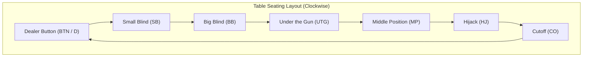
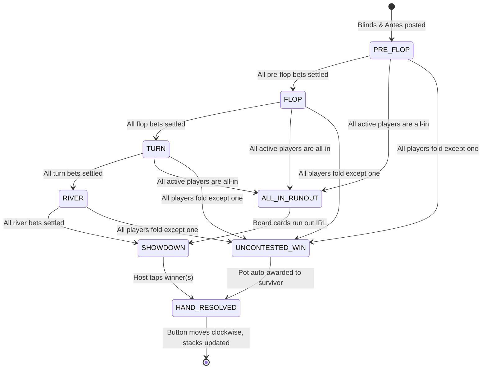
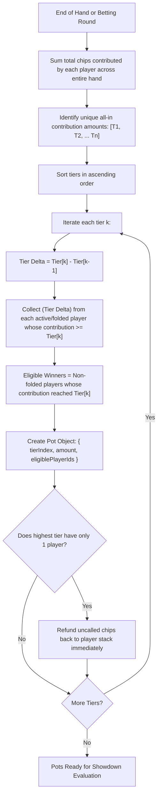

# Texas Hold'em Game Logic & Betting Rules Specification

## 1. Introduction & Hybrid Operational Model

**Poker Credits** serves as an authoritative digital companion for in-person Texas Hold'em games:
* **Cards (Physical)**: Players shuffle, cut, deal, and reveal physical cards on the table.
* **Credits / Chips (Digital)**: The application manages all financial and betting rules: blinds, turn order, minimum raise validation, all-in side pot calculations, and split pot payouts.

This document details the exact rules, state transitions, constraints, and edge-case behaviors implemented in the Rust crate `crates/poker_engine`.

---

## 2. Table Seating & Positions

The table accommodates **2 to 10 players**. Seating positions determine both the turn order and forced bets:



### 2.1. Standard Full-Ring / Shorthanded (3–10 Players)
1. **Dealer Button (D / BTN)**: Rotates clockwise by 1 seat after every completed hand.
2. **Small Blind (SB)**: First active seat immediately to the left of the button.
3. **Big Blind (BB)**: Second active seat immediately to the left of the button.
4. **Pre-Flop Action Order**: Starts with **Under the Gun (UTG)** (left of Big Blind) and proceeds clockwise; Small Blind acts second-to-last, Big Blind acts last.
5. **Post-Flop Action Order (Flop, Turn, River)**: Starts with the **Small Blind** (or first active player left of the button) and proceeds clockwise; the Button acts last.

### 2.2. Heads-Up Exception Rules (Strict 2-Player Play)
When only 2 players are seated at the table, standard Texas Hold'em reverses the blind order:
* **The Dealer Button (BTN)** posts the **Small Blind** and acts **FIRST** pre-flop, but acts **LAST** post-flop.
* **The Non-Dealer** posts the **Big Blind** and acts **LAST** pre-flop, but acts **FIRST** post-flop.

```
Heads-Up Summary Table:
+----------------+--------------+------------------+-------------------+
| Player         | Blind Posted | Pre-Flop Order   | Post-Flop Order   |
+----------------+--------------+------------------+-------------------+
| Dealer (BTN)   | Small Blind  | Acts 1st (first) | Acts 2nd (last)   |
| Big Blind (BB) | Big Blind    | Acts 2nd (last)  | Acts 1st (first)  |
+----------------+--------------+------------------+-------------------+
```

---

## 3. Forced Bets: Blinds & Modes

Before physical cards are dealt, the app automatically deducts forced bets:

### 3.1. Cash Game Mode (Fixed Blinds)
* Fixed Small Blind and Big Blind values (e.g. $10 / $20).
* Values remain constant throughout the game unless manually modified by the table host.

### 3.2. Tournament Mode (Escalating Blind Levels)
* Features a synchronized **Tournament Clock**.
* Blinds increase according to a pre-defined schedule (e.g., Level 1: $10/$20, Level 2: $15/$30, Level 3: $25/$50 every 15 minutes).
* Supports optional **Antes** (collected from all players or via Big Blind Ante) starting at designated blind tiers.

---

## 4. Street Progression & Hand Lifecycle



### 4.1. Street Completion Invariant
A betting street is complete and advances to the next stage if and only if **both** of the following conditions are met:
1. **Equal Contribution**: Every active (non-folded, non-all-in) player has contributed an identical amount to the current street's pot.
2. **Every Player Has Acted**: Every active player has had at least one opportunity to act in this street (e.g. the Big Blind pre-flop must have the option to check or raise even if all players called).

### 4.2. All-In Fast-Forward (ALL_IN_RUNOUT)
If all active non-folded players are all-in (no one has chips left to wager), **no further betting can occur**.
* The app transitions to `ALL_IN_RUNOUT` state.
* A notification prompts the physical dealer to deal the remaining board cards (Flop, Turn, River) as required.
* Each remaining street is skipped without a betting round and the hand advances straight to **Showdown**.

### 4.3. Sit-Out Rule
A player may choose to **Sit Out** between hands (e.g., they stepped away). While sitting out:
* They are skipped in all blind rotations and turn orders.
* If they are due to post the Big Blind, a **missed blind** is recorded. When they return, they must post the missed big blind before being dealt in, or they wait until they are back in the BB position naturally.
* A player may not sit out during an active hand; they must wait until the next hand begins.

---

## 5. Player Actions & Betting Constraints

### 5.1. Fold
* The player forfeits their cards and any claim to the current pot.
* Removed from the turn rotation for the remainder of the hand.
* If only 1 player remains in the hand, the hand terminates immediately without showdown.

### 5.2. Check
* Passing action to the next player without adding chips.
* **Legality Rule**: A player may **ONLY** check if the current high bet on this street is $0, or if the player has already matched the high bet (e.g., the Big Blind pre-flop facing limpers).
* If a prior player has bet or raised, `CHECK` is illegal and the UI automatically switches the action to `CALL`.

### 5.3. Call
* Matching the current high bet on the street:
  $$\text{Call Amount} = \text{Current High Bet} - \text{Player's Current Street Contribution}$$
* **All-In Call**: If the player's total remaining stack is less than the call amount, the player is considered **All-In** for their full stack, creating a side pot.

### 5.4. Bet & Raise Constraints (No-Limit Hold'em Rules)
* **Minimum Opening Bet**: Must be at least equal to the current **Big Blind**.
* **Minimum Raise Size**:
  In No-Limit Hold'em, a raise must be at least equal to the size of the previous bet or raise in that betting round:
  $$\text{Min Raise To} = \text{Current High Bet} + \max(\text{Big Blind}, \text{Previous Raise Delta})$$
  
  *Example*:
  1. Big Blind is **$20**.
  2. Player 1 raises to **$60**. The raise delta is $\$60 - \$20 = \$40$.
  3. Player 2 wants to re-raise. The minimum re-raise must be at least $\$60 + \$40 = \mathbf{\$100}$.

* **Maximum Raise**: Any amount up to the player's entire remaining stack (All-In).

### 5.5. The Incomplete / Short All-In Rule
If a player goes All-In for an amount that is less than the full minimum raise:
* It is a legal action for the all-in player.
* **Bet Reopening Rule**: It does **NOT** reopen the betting action for any player who has already acted, unless a subsequent player makes a full, legal raise.

---

## 6. Main Pot & Side Pot Algorithm

The app automatically calculates multiple side pots when players with unequal chip counts go all-in.



### Concrete Multi-Way All-In Scenario

Consider 4 players with the following starting stacks:
* **Alice**: $100
* **Bob**: $250
* **Charlie**: $600
* **Dave**: $600

**Hand Progression**:
1. Alice goes All-In for **$100**.
2. Bob goes All-In for **$250**.
3. Charlie Raises to **$500**.
4. Dave Folds after having contributed **$40** in prior betting.
5. All betting closes. Total chips on table = $\$100 + \$250 + \$500 + \$40 = \$890$.

**Tier Calculation**:
* **Step 1: Uncalled Bet Refund**:
  Charlie bet $500, but the nearest caller (Bob) only contributed $250. Charlie's uncalled $\$250$ is **immediately refunded** to Charlie's stack. 
  Active pot pool is now $\$890 - \$250 = \mathbf{\$640}$.
* **Tier 1 (Main Pot)**: Capped at Alice's $100.
  * Alice ($100) + Bob ($100) + Charlie ($100) + Dave ($40) = **$340**.
  * **Eligible to win Main Pot**: **Alice, Bob, Charlie**.
* **Tier 2 (Side Pot 1)**: From $100 to Bob's $250 ($150 delta).
  * Bob ($150) + Charlie ($150) = **$300**.
  * **Eligible to win Side Pot 1**: **Bob, Charlie**.

---

## 7. Showdown Payouts & Split Pots

### 7.1. Showdown Resolution Order
At showdown, pots are evaluated in **reverse order** (highest side pot first, down to the main pot):
1. **Side Pot 1 ($300)**: Evaluated between Bob and Charlie. Winner takes the $300.
2. **Main Pot ($340)**: Evaluated between Alice, Bob, and Charlie. Winner takes the $340.

### 7.2. Split Pots & The Odd-Chip Rule
When two or more eligible players tie with the exact same hand strength:
* The pot is divided equally among the winning contenders:
  $$\text{Base Payout} = \lfloor \frac{\text{Pot Amount}}{N} \rfloor$$
* **Odd-Chip Distribution (Official Rule)**:
  Chips cannot be split into fractional cents. If an indivisible remainder exists (e.g. $101 split between 2 winners leaves 1 odd chip):
  * The extra odd chip is awarded to the winning player seated in the **earliest position clockwise from the Dealer Button (D)**.

---

## 8. Player Lifecycle & Table Management

### 8.1. Bustouts & Rebuys
* When a player's chip balance reaches **$0**, they are marked as `BUSTED`.
* Busted players do not participate in hands and are skipped during turn/blind rotations.
* Players may request a **Rebuy / Top-Up** from their mobile controller between hands; the host confirms the reload.

### 8.2. Disconnections & Turn Timeouts
* Central table displays an optional **Turn Timer** (e.g., 30 seconds).
* If a player's timer expires without an action:
  * If the player can legally **Check** for free, the engine executes an automatic `CHECK`.
  * If facing an active bet/raise, the engine executes an automatic `FOLD`.

---

## 9. Engine decisions (Phase 1, for owner review)

The spec above left these open. The engine implements the following; each is covered by a test in `crates/poker_engine/tests/`. Tell us if a house rule differs.

1. **Run-out trigger.** Betting ends and the hand goes to `ALL_IN_RUNOUT` as soon as at most one non-folded player still has chips and every bet is matched. (A lone player with chips is never asked to check through the remaining streets against an all-in opponent.)
2. **Uncalled bet.** The top contribution minus the second-highest contribution among *all* contributors, folded players included, goes back to its owner when betting ends. A folder who matched part of a bet counts as having called that part.
3. **Folded chips.** Folded players' chips fill pots but never create a pot of their own; only non-folded players who reached a tier can win it. A folded overbet above the highest live tier is added to the last pot.
4. **Short (incomplete) all-in (TDA rule 47).** It is legal. It does not change the minimum raise increment. On its own it does not reopen raising for players who already acted: they may only call or fold (`BettingNotReopened`). Several short all-ins whose increases together reach a full raise do reopen betting for everyone (the increment stays that of the last full raise). Players who have not acted yet may always raise. An all-in at or above the minimum raise is a full raise and reopens betting for everyone.
5. **Minimum raise.** `current bet + last full raise increment`; after the flop the first bet must be at least the big blind. A raise below the minimum is rejected unless it is the player's whole stack.
6. **Odd chips.** Applied per pot. Everyone gets the floor share; the remainder goes one chip at a time to the winners in clockwise order starting with the first seat after the button (a remainder above one is spread, not given to one player).
7. **Pots are paid highest side pot first**, main pot last. Every pot needs an allocation; a winner must be eligible for that pot.
8. **Button and blinds (dead-button rule).** The big blind moves to the next player who can be dealt in, so nobody skips it. The small blind is the seat just before the big blind, the button the seat before that. If the small blind seat cannot be dealt in (busted or sitting out) the small blind is dead and nobody posts it. If the button seat cannot be dealt in the button is dead; it still marks where post-flop action starts.
9. **Heads-up.** With exactly two players who can be dealt in, the button posts the small blind, acts first before the flop and last after it. Going from three players to two, the big blind still rotates to the next player and the other player takes the small blind and the button.
10. **Missed blinds (owner decision 2026-11-02).** No catch-up post. A player who leaves or sits out is skipped, and when they come back they wait for the next hand and are dealt in with whatever position the rotation gives them.
11. **Sit-out timing.** Toggling sit-out during a hand only takes effect from the next hand. `LeaveHand` is the immediate version: a player who is live in the hand folds at once (even out of turn, so the hand never waits on someone who has gone), then sits out. An all-in player who leaves stays in the hand for the showdown. Coming back is `SetSittingOut false`, which applies from the next deal. Removing a player or topping up a stack is only allowed between hands.
12. **Antes** are posted by every player dealt in (up to their stack), go to the pot, and are not part of the street bet.
13. **Short blinds.** A player who cannot cover a blind posts what they have and is all-in. The call amount is still the full big blind.
14. **Timeout.** The engine decides: check if the player owes nothing, otherwise fold. The event is flagged `auto`.
15. **Game over.** When one player (or nobody) has chips after a payout the table returns to `LOBBY`; the host can top players up and start again.
16. **Pause** is a flag, not a phase, so resuming restores the exact street and turn. It is only possible during a betting street. Undoing while paused keeps the game paused.
16a. **Seat order is chosen by the people, and the seats are the turn order.** A joiner takes the first free seat. Before the first hand a guest can move into any free seat (`CHOOSE_SEAT`); the host can move any player anywhere, swapping with whoever is there (`MOVE_SEAT`), in the lobby and between hands (`LOBBY` or `NEXT_HAND_PREP`), never during a hand, because then the seat order is the action order and the pots refer to seats. Guests cannot hop seats once the game is running, since that would let them dodge the big blind. The button and blind markers belong to the *chair*, not the person: after a swap they stay on the same seat numbers, exactly like a physical dealer button that stays on its chair. Moving clears the undo history. Seats run 0 to 9 clockwise; the app shows them as 1 to 10, with seat 1 at the bottom of the table screen. The engine, not the app, keeps the order (`Command::MoveSeat`).
17. **Undo** steps back up to 5 commands (actions, deals, showdown steps). Seating, top-ups and blind changes clear the history.
18. **Phases.** The wire phases `STARTING_HAND`, `POSTING_BLINDS` and `PAYOUT` are not stored: one `StartHand` posts everything and lands on `PRE_FLOP` (or `ALL_IN_RUNOUT`), and a payout lands on `NEXT_HAND_PREP`. The server maps the `paused` flag to the wire phase `PAUSED`.
19. **Busted seats stay seated.** Decision 8 assumes a player with no chips keeps their seat (and `Seat` entry) until the host sends `RemovePlayer`. If the server removes busted players before the next deal, the dead-small-blind and dead-button outcomes change. Phase 2 must choose the removal timing on purpose.
20. **Removing a player returns their chips in the event** (`PlayerRemoved.chips`). The server must credit them to the room ledger, otherwise a kicked or departed player's credits vanish.
21. **Auto sit-out.** A turn that ends by `Timeout` counts as a missed turn. Two in a row sit the player out when the hand ends and emit `PlayerAway`; any real action or sitting back in resets the count. See `RESILIENCE_AND_CRASH_HANDLING.md` section 3.8 for the presence check and vote built on top (server, Phase 2).

---

## 10. Virtual cards mode (ADR-016)

Sections 1 to 9 describe the shipped behaviour with **physical cards**. A room may instead be created in **virtual-card mode**; physical stays the default and nothing above changes for it. The mode is fixed at creation. Full design: `docs/superpowers/specs/2026-11-07-virtual-cards-design.md`.

* **Deal.** The server shuffles one 52-card deck per hand (OS entropy, unbiased) and passes the order to the engine in `StartHand`. Dealt seats (those `Live` at hand start) get two cards each in seat order from the button; five board cards follow. Burn cards do not exist.
* **Board.** 0 cards pre-flop, 3 on the flop, 4 on the turn, 5 on the river. When betting ends early (all-in run-out) the server reveals the whole board at once; the app deals it onto the screen one street at a time, 700 ms apart (`RunoutPacer`), and holds the winners, the revealed hands and the host's START HAND until the last card is down, so the result is never shown before the cards. The count is stored in the deal state, not derived from the phase (a hand won on the flop keeps showing three).
* **Showdown.** Betting ends with one contender: the pot is paid and **nothing is revealed**. Two or more: **all contenders reveal** (no muck choice in v1), pots are awarded from the last side pot to the main pot by hand rank, ties split, and the odd-chip rule of 7.2 applies. The server does this itself (`Op::AutoShowdown`, journaled, so a restart replays the same payout); the host's manual showdown commands are refused in virtual rooms. Every player and spectator sees every revealed hand with its category, the winner of each pot and the amount each receives (the result stays until the next hand starts): on the Player screen as the showdown list, on the Table as the cards on each plate, a WINS tag and one line per pot. Folded hands are never shown, and a folded player's own cards disappear from their dock.
* **Ranking.** Best five of the seven available cards. Categories high to low: straight flush (royal is the ace-high one), four of a kind, full house, flush, straight (ace plays high or low: A-2-3-4-5 is the lowest straight), three of a kind, two pair, pair, high card. Ties compare the ordered tie-break ranks (kickers); suits never break ties; the board can play.
* **Undo.** Allowed only within the current betting street (it must not let players re-bet after seeing a new card). Past that the server answers `ILLEGAL_STATE` and the host's controls say so in one line.
* **Unchanged.** Blinds, button, betting, side pots, timeouts, sit-outs, rebuys, tournament levels.

## 11. Bots (ADR-018, built)

Bots follow the same rules as humans because they act through the same engine commands and validator; they have no special powers and no information beyond their seat's view. Strategy facts (spec `docs/superpowers/specs/2026-11-07-single-player-bots-design.md`, section 4): 169-entry preflop strength table adjusted by position and players; postflop Monte Carlo equity against the live opponents with a skill-dependent sample cap (Easy 0, Normal 120, Hard 400) using the engine's 7-card ranker; decisions combine equity, pot odds and stack-to-pot ratio with personality parameters (looseness, aggression, bluff, trap, size habit, tilt, think speed, read weight); opponent notes (VPIP, PFR, aggression, fold-to-bet, showdown evidence) are smoothed counters per opponent. Solo is a freeze-out tournament: no rebuys, busted players (bots and human) are out and take a finishing place, the game ends when the human is out or holds every chip, and blinds rise by hand count through an optional `hands_per_level` on the engine's `Tournament` blinds (levels 1x, 1.5x, 2x, 3x and so on; ignores elapsed time, so it is replay-safe and pause-safe). 

**Tuned constants (as built, `crates/poker_bots/src/skill.rs`, `decide.rs`):**
- Equity samples: Easy 0 (preflop table and made-hand strength only), Normal 120, Hard 400, capped by a wall-clock budget of 8 ms per decision (`EQUITY_BUDGET`; simulations pass `None` so fixed seeds give the same games everywhere).
- Error rate (a deliberate slip: wrong size, a missed value bet, a bad fold): Easy 0.16, Normal 0.06, Hard 0.02. Decision noise on the equity: 0.12 / 0.05 / 0.02.
- Reads: a bot starts using its notes about an opponent after MAX (never) / 25 / 10 observed hands, and weighs them 0 / 0.5 / 1.0.
- 6 archetypes (each with jittered parameters) and a pool of 40 names; names never repeat at a table and never equal the human's. Seats are spread over the ten seats; from 3 bots a table has one "rival" (6 or more: two): the same style as its archetype but it trusts its reads more, so the table has a player or two who adapts to the human.
- Solo setup: 1500 chips each (75 big blinds), blinds 10/20, virtual cards, no turn timer, bots wait `bot_next_hand_ms` (3000) between hands. Blind ladder: `ladder_hands` hands per level (the app offers Quick 6, Standard 8, Long 12), levels are the base blinds times 1, 1.5, 2, 3, 4, 6, 8, 12, 16, 24 (`LADDER_HALVES` in half units, the last level stays).
- **Thinking time (human pacing):** `decide::think_time` gives every decision 0.7 to 11 s: an easy preflop fold 0.7-1.5 s, a check 0.9-2 s, a call 1.5-3.2 s, a raise 1.8-3.8 s, an all-in 2.2-4.5 s; a close decision adds up to 4.5 s; with 30% or more of the stack at stake (or an all-in) there is a 30-60% chance of a 3-8 s tank; the river is 20% slower; the bot's own speed scales it (x0.75 to x1.35); 8% of decisions are snap decisions (half time). Timing draws from its own generator (one draw from the decision stream), so it can never change which hands are played. The server adds `bot_look_ms` (1.4 s: nobody acts sooner than that after a deal or a new street), and the pause before the next deal is `bot_next_hand_ms` (3.5 s) plus `bot_showdown_ms` (3 s) after a showdown plus `bot_runout_step_ms` (1.6 s) for every street after the first of a run-out. The app's own pacing (`RunoutPacer.step` 1.3 s, a card flip 460 ms, 260 ms between the flop's cards) is shorter than these, so a bot never acts before the cards it reacts to are on screen.
- **Learned numbers:** the judgement constants live in `poker_bots::Tuning` (16 numbers, `tuning.rs`). `Tuning::BASE` is the hand-set vector; `Tuning::LEARNED` is what `cargo run --release -p poker_bots --example train -- 60 8000 1` found (an evolution strategy with mirrored sampling over self-play: a Tag-style Normal bot against the other five styles, common random numbers per generation, fitness = bb/100 minus a penalty for leaving the style envelope: plays 20-32% of hands, folds 12-27% of postflop bets). `train eval <vector> 40 6000` compares a vector with BASE on fresh seeds. Adopted: +109 +- 44 bb/100 over BASE, 32% of hands played (BASE 20%), 25.6% postflop fold share (BASE 24%); `post_margin` was set by hand from 0.106 to 0.075 to keep the fold share down. Training is offline: the app ships fixed numbers and runs no model. Re-train after any change to the decision code, and re-check `measure_fold_rates` (`cargo test --release -p poker_bots --test sim measure_fold -- --nocapture`).
- **Stability:** the equity sampler is seeded from the spot (own cards, board, opponent count), so the same spot always gives the same estimate and a bot does not flip between call and fold on resampling noise.
- **Play levels (6 players, Normal):** Rock 13%, Tag 19%, Nit 16%, Lag 44%, Station 40%, Maniac 56% of hands (before the learned vector); the preflop ranges were widened and blind defence, commitment and continuation bets added because the first version folded 88% of hands for three of the six styles.
- A solo room lives seven days without activity (`SOLO_TTL`) so a put-down game can be resumed.
- Simulations (`poker_bots/tests/sim.rs`, `poker_server_core/tests/bots_sim.rs`): `hard_beats_easy_and_normal_sits_between` holds over fixed-seed hands, `no_seat_advantage` and `bot_view_invariance` (also with warm notes) hold, a nine-bot game always reaches a winner, and 100 soaked games never stall.
