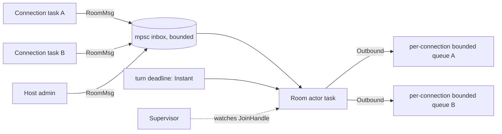

# Resilience & Crash Handling

How Poker Credits survives crashes, OS suspension, network loss and bad input. The strategy is modelled on LocalSend (`~/Documents/dev_projects/localsend`). Each item is marked:

- **[LS]** copied from LocalSend, with the file to read.
- **[NEW]** not present in LocalSend, designed here.

Rule for implementers: a failure in one room, one connection or one screen must never take down the process, other rooms, or the chip balances.

---

## 1. Failure map

| Failure | Where | Response |
| :--- | :--- | :--- |
| Exception during startup (storage, native lib load, permissions) | Dart `preInit` | Show the init error app with copyable details **[LS]** |
| Uncaught Dart error after startup | Dart | Log to file, keep app alive, show non-blocking error banner **[NEW]** |
| Rust panic inside a room | Server core | Log backtrace, restart that room from its journal, tell clients **[NEW]** |
| Rust panic crossing the FRB boundary | Bridge | FRB converts it to a Dart `PanicException` with a Rust backtrace (verified in the Phase 0 spike, `docs/SPIKE_BRIDGE_FINDINGS.md`); the bridge layer catches it and reports a typed error. Panics in background tokio tasks are NOT reported by FRB; the room supervisor reports them as events **[NEW]** |
| Listening socket dies (iOS suspension, interface change) | Host mode | Event from Rust triggers restart **[LS]**; probe on resume **[LS]** |
| Host app killed by the OS | Host mode | On next launch, restore rooms from snapshot + journal **[NEW]** |
| Client loses connection (screen lock, Wi-Fi blip) | Client | Backoff reconnect, resume handshake, full snapshot **[NEW]** |
| Client sends garbage / floods | Server | Reject, rate limit, disconnect repeat offenders **[LS]** pattern |
| Slow client cannot drain messages | Server | Drop that connection; client resumes **[NEW]** |
| Second app instance on desktop | Desktop | Hand over to the running one and exit **[LS]** |

---

## 2. Dart side

### 2.1 Startup guard **[LS]**
`app/lib/main.dart`:

```dart
Future<void> main(List<String> args) async {
  final RefenaContainer container;
  try {
    container = await preInit(args);
  } catch (e, st) {
    showInitErrorApp(error: e, stackTrace: st); // copyable error + app version
    return;
  }
  runApp(...);
}
```

Reference: `localsend/app/lib/main.dart`, `app/lib/config/init_error.dart`. `preInit` order to copy from `app/lib/config/init.dart`: bind the Flutter binding, init logger, init the Rust library, init persistence, desktop single-instance check, window and tray setup, build the container, start the server layer last.

### 2.2 Global error hooks **[NEW]**
LocalSend only uses `runZonedGuarded` inside child isolates (`packages/localsend_isolates/lib/src/isolate/child/main.dart`: "Uncaught async errors are fatal to the isolate by default, which would silently kill the server/upload loop; log them instead."). We apply the same idea to the main isolate:

- `FlutterError.onError` logs framework errors.
- `PlatformDispatcher.instance.onError` logs uncaught async and platform errors and returns `true` so the app keeps running.
- `runZonedGuarded` wraps `runApp` as the last net.
- Logs go to a rotating file in the app support directory (3 files x 1 MB) and to the console. The Settings screen has "Copy diagnostics" which includes version, platform and the last 200 log lines.
- Never swallow silently: every handler logs with stack trace.

### 2.3 Lifecycle recovery **[LS]**
Copy `LifeCycleWatcher` handling from `localsend/app/lib/main.dart`:

| State | Action |
| :--- | :--- |
| `resumed` (iOS, Android) | If hosting, run `ensureRunning()`: loopback `Socket.connect` with 1 s timeout, restart server on failure (`server_provider.dart`). If playing, trigger an immediate client reconnect. Re-request wake-lock. |
| `inactive` / `paused` | Do nothing destructive. Hosting on Android relies on the foreground service. |
| `detached` | Dispose server handle and sockets cleanly. |

Server restart keeps the room alive: it restores from journal (section 3.4), so players reconnect into the same hand.

### 2.4 Server-layer errors as events **[LS]**
The Rust server emits a single typed `ServerEvent` enum over a channel exposed to Dart by FRB as one stream (LocalSend: `ServerEventV2` → `RsServerEvent`). New server-to-app interactions extend the enum. No side channels. Error variants include `ListenerFailed { error }` and `RoomRecovered { room, reason }`. Dart routes events to providers; the providers are event handlers, not route handlers.

### 2.5 Android, iOS, desktop specifics
- **Android** host mode: foreground service with a persistent notification while a room is hosted (LocalSend has `foreground_service.dart` in `packages/localsend_isolates/lib/util/`). Take a multicast lock only when discovery is on. No cleartext exception is expected to be needed for `dart:io` and Rust sockets (verify on a device in Phase 5).
- **iOS**: sockets silently die while suspended; this is why probe-on-resume exists. Add `NSLocalNetworkUsageDescription`. Keep hosting on iOS best-effort: documented as "keep the app in the foreground" because iOS does not allow a general background server.
- **Windows**: first bind triggers the firewall prompt; the host screen explains it. Single instance via the handover pattern.
- **Linux/macOS**: same as Windows without the prompt.

---

## 3. Rust side

### 3.1 Process rules
- `panic = "unwind"` (default). Never set `panic = "abort"` in any profile.
- Install a panic hook at startup (`std::panic::set_hook`) that logs message, location and backtrace through `tracing`, then chains to the previous hook. **[NEW]**
- No `unwrap()` / `expect()` / indexing that can panic in request paths. Allowed only on provably-infallible constants and in tests. Enforce with `#![deny(clippy::unwrap_used, clippy::expect_used, clippy::indexing_slicing)]` in `poker_server_core` (engine too, with tests exempt).
- Logging: `tracing`. On Android route to logcat with `tracing_android` **[LS]** (`localsend_isolates/rust/src/api/logging.rs`), because Android discards native stdout/stderr.

### 3.2 Room actor model **[NEW]**
Replaces the old Promise-chain queue.



- One tokio task per room owns `RoomState` exclusively. No locks around game state.
- The actor loop is `loop { select! { msg = inbox.recv() => handle(msg), _ = sleep_until(deadline) => on_timeout() } }`. Actions and timer expiry are processed one at a time in arrival order, so a late action and a timer expiry can never interleave (fixes RC-001 and RC-003 by construction).
- `handle` calls the pure engine: `engine::apply(&state, cmd) -> Result<Transition, PokerError>`. State is replaced only on `Ok`.
- Each `Connection` has a bounded outbound queue (default 64 messages). If a push fails because the queue is full, the actor marks that connection dead and closes it. The client reconnects and gets a snapshot. The room never waits on a slow phone.

### 3.3 Supervision and panic policy **[NEW]**
- A `Supervisor` owns `HashMap<RoomCode, RoomEntry { handle, join: JoinHandle<()> }>`.
- When a room task finishes with `JoinError::is_panic()`:
  1. log room code, panic payload, backtrace;
  2. rebuild state from the last snapshot plus journal (3.4);
  3. spawn a fresh actor, re-attach live connections (they are held by the connection tasks, which keep their `RoomHandle` behind a swappable `watch` channel), send everyone a `SNAPSHOT` plus a `ROOM_RECOVERED` notice;
  4. if the same room panics 3 times within 60 s, freeze it: state `Frozen`, send `ROOM_CRASHED`, keep snapshot on disk for support, other rooms unaffected.
- A panic in a connection task only closes that connection.
- The engine is pure, so a deterministic bug would replay into the same panic. The "3 strikes then freeze" rule stops a restart loop; the journal entry that triggers the panic is recorded as `poisoned` and skipped on the next replay, with a visible "last action discarded" notice to the host.

### 3.4 Snapshot + write-ahead journal **[NEW]** (amends ADR-006)
Because the engine is deterministic (no RNG, no clock inside it), state = `snapshot ⊕ ordered commands`.

- **Snapshot**: full `RoomState` JSON, written atomically (write temp file, `fsync`, rename) at: room creation, end of every hand (`PAYOUT`), config change, rebuy applied.
- **Journal**: append-only file per room, one JSON line per accepted command (`seq`, `playerId`, command, `at` timestamp supplied by the actor, not the engine). Appended **before** the new state is broadcast. `fsync` per line is affordable at poker action rates.
- **Restore**: load snapshot, replay journal lines in order through `engine::apply`. Truncated final line (power loss mid-write) is ignored and logged.
- **Compaction**: a new snapshot truncates the journal.
- Undo is a journal operation: an `UNDO` entry removes the last accepted command from the replay set (engine keeps its own 5-deep stack for live play; replay must give the same result, covered by a property test).
- Location: host mode `<app_support_dir>/rooms/<ROOM>/`; cloud mode `$POKER_DATA_DIR/rooms/<ROOM>/`.
- Retention: delete a room's directory when the room expires (60 min idle) or the host ends the game.

### 3.5 Cancellation safety with drop guards **[LS]**
LocalSend uses guards such as `PendingSessionGuard` and `UploadGuard` (`packages/core/src/http/server/v2.rs`) so that if a request future is dropped mid-flight, shared state is cleaned up. We use the same idiom for:
- `SeatReservationGuard`: a join in progress holds a seat; dropping the connection task before the join completes releases it.
- `ConnectionGuard`: on drop, decrements the per-IP counter and notifies the room actor `Disconnected(conn_id)`.
- Any `.await` between "reserve" and "commit" in the server must be covered by a guard.

### 3.6 Connection hygiene **[LS]**
From `localsend/server/src/controller/ws_controller.rs` and `config/scheduler.rs`:

| Control | Value (default, configurable) |
| :--- | :--- |
| Client ping when no outgoing message | every 15 s (LocalSend: 120 s; poker needs faster dead-link detection) |
| Server idle timeout (no frame received) | 45 s then close |
| Max connections per IP | 40 (LocalSend limits per IP; a full home table of 10 players, 20 spectators and the table screen can all sit behind one NAT address, plus reconnect overlap; also bounded by total rooms) |
| Max message size | 16 KiB |
| Per-connection rate limit | 10 messages/s sustained, burst 20; violation closes after 3 strikes **[NEW]** |
| Request/connection counters | cleared hourly by a `tokio::time::interval` task |
| Room TTL | 60 min of no activity |

### 3.7 Embedded server API shape **[LS]**
Mirror `packages/core/src/http/server` and `localsend_isolates/rust/src/api/server.rs`:

```rust
pub struct ServerConfig { pub bind: SocketAddr, pub data_dir: PathBuf, pub limits: Limits, pub event_tx: mpsc::Sender<ServerEvent> }
pub async fn start(cfg: ServerConfig) -> Result<ServerHandle, StartError>;
impl ServerHandle { pub async fn stop(self); pub fn local_addr(&self) -> SocketAddr; }
```

FRB exposes an opaque `RsServerHandle` plus one `Stream<RsServerEvent>`. The cloud binary calls the same `start` with a different config.

---

## 4. Client reconnect and resume

### 4.1 Reconnect loop **[NEW]**
- Backoff: 0.5 s, 1 s, 2 s, 4 s, 8 s, then cap 10 s, each with ±20% jitter. Reset to 0.5 s after a connection stays up 10 s.
- Triggered by: socket close/error, missed pong (45 s), app `resumed`.
- UI during reconnect: non-blocking banner "Reconnecting…", action buttons disabled. After 30 s show "Still trying" with a manual retry and "Leave room".

### 4.2 Resume handshake **[NEW]**
Detailed in `API_AND_EVENTS.md` section 5. Essence: client sends `RESUME { roomCode, sessionToken, lastStateVersion }`. Server answers `SNAPSHOT` (always full, never a delta) containing `stateVersion`. Client replaces its entire view state. Idempotency of in-flight actions is protected by `actionSeq`.

### 4.3 Server grace behaviour
- On disconnect the seat stays reserved; `isConnected=false` is broadcast.
- If it is that player's turn: 30 s grace, then auto-check if free else auto-fold (rule unchanged from `SECURITY_AND_EDGE_CASES.md`).
- A seat with no connection for 10 minutes is flagged `sitting_out` automatically; it is still reclaimable with the token.

---

## 5. Test obligations

| Behaviour | Test |
| :--- | :--- |
| Engine deterministic | Property test: same command list gives same state |
| Chip conservation | Property test: sum of stacks + pots is constant across any legal action sequence |
| Journal replay equals live state | Property test over random legal hands, including undo |
| Truncated journal tail | Unit test with cut file |
| Room panic isolated | Integration test: inject panic via test-only command; other room keeps working; room restored |
| Freeze after 3 panics | Integration test |
| Slow consumer dropped | Integration test with a client that never reads |
| Resume gives full snapshot | Integration test: disconnect mid-hand, resume, state equals broadcast state |
| Reconnect backoff | Dart unit test with fake clock |
| Init failure shows error app | Dart widget test |
| Protocol fixtures | Rust and Dart tests read `protocol/fixtures/*.json` |
| Listener death restart | Integration test: close listener, expect `ListenerFailed` then restart |
