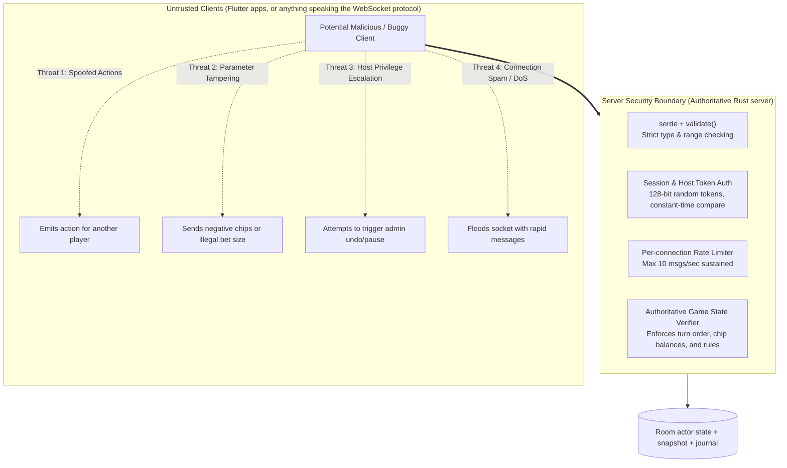
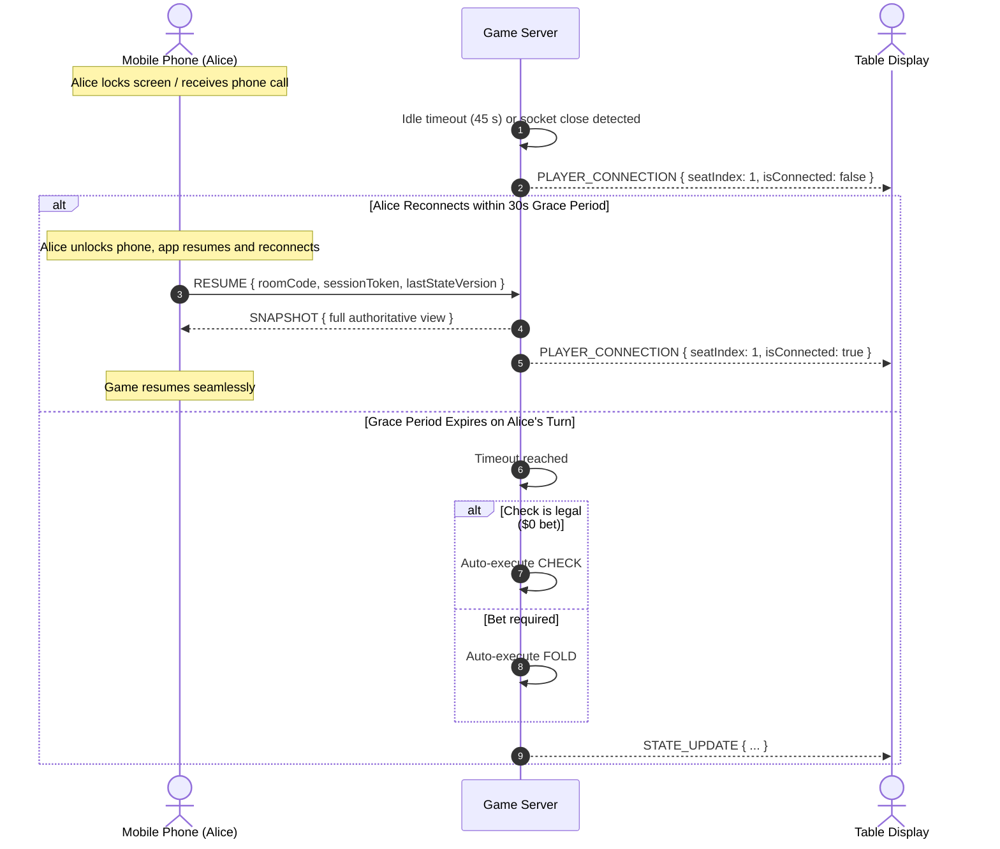
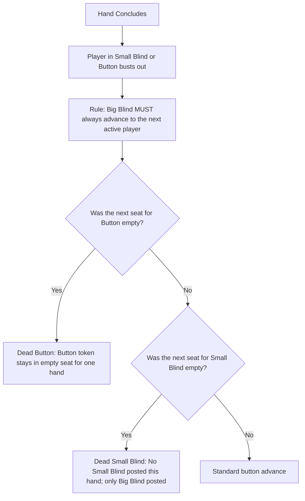
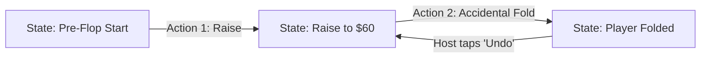

# Security & Edge Cases Specification: Poker Credits

## 1. Threat Model & Security Architecture

Even in home games, a digital companion app managing financial credits and pot distributions must be cryptographically sound, resilient to network disruption, and immune to client-side manipulation.



---

## 2. Core Security Controls

### 2.1. Authoritative Server Enforcement (Zero-Trust Client)
* **Clients are purely presentation displays**: The client never computes its own chip deductions or decides if a bet was successful.
* **Strict State Verification**:
  * The server checks:
    1. Is the incoming socket authenticated to the seat making the claim?
    2. Is it currently that seat's turn to act?
    3. Is the action legal on this street (e.g., cannot check if high bet > player's contribution)?
    4. Does the player have sufficient chips in their stack?
    5. Is the raise amount at least the required minimum raise?

### 2.2. Session Authentication & Impersonation Prevention
To prevent one player or spectator from spoofing actions for another player:
* Upon joining a room, the server issues a random 128-bit `sessionToken` from the OS RNG (`getrandom`). The server stores only a SHA-256 hash of it (in memory and in snapshots); comparison is constant-time (`subtle`).
```rust
pub struct PlayerSession {
    pub token_hash: [u8; 32],   // never the raw token
    pub player_id: PlayerId,    // public id
    pub room_code: RoomCode,
    pub seat_index: Option<SeatIndex>,
    pub role: Role,             // Host | Player | Spectator
    pub next_action_seq: u64,   // monotonic per session, advances only on applied actions
}
```
* The client keeps the raw token in **platform secure storage** (Keychain, Keystore, DPAPI/libsecret via a secure-storage plugin), not in plain preferences. If secure storage is unavailable the token is held in memory only and a restart requires re-joining.
* The first message on a connection must be `CREATE_ROOM`, `JOIN_ROOM` or `RESUME` (`NOT_AUTHENTICATED` otherwise). After that, the connection is bound to exactly one `playerId`; any message that names another player is rejected with `HOST_ONLY_ACTION` or `INVALID_SESSION` as appropriate. The server derives the acting player from the connection, never from a field in the message.

### 2.3. Host Privilege Protection
* Administrative functions (e.g. `UNDO`, `PAUSE`, `APPROVE_REBUY`, `ROOM_CONFIGURE`) require a dedicated `hostToken`.
* The `hostToken` is generated when the room is created and stored by the host app in secure storage (and, hashed, by the server).
* If a host disconnects, host status can only be reclaimed using this secret key.

### 2.4. Input Validation
* Player names, room codes and any free text are validated in the server's `validate()` step:
```rust
pub fn validate_name(raw: &str) -> Result<String, ErrorCode> {
    let n = raw.trim();
    let ok_len = (1..=20).contains(&n.chars().count());
    let ok_chars = n.chars().all(|c| c.is_ascii_alphanumeric() || c == ' ' || c == '_' || c == '-');
    if ok_len && ok_chars { Ok(n.to_owned()) } else { Err(ErrorCode::NameInvalid) }
}
```
* Flutter `Text` widgets do not interpret markup, so there is no XSS class of bug in the native app. Names are still restricted to a safe charset so they cannot break logs or a future web guest page.
* Maximum frame size 16 KiB; larger frames close the connection.

### 2.5. Rate Limiting & Denial-of-Service (DoS) Mitigation
* **Connection Throttling**: 10 messages per second sustained (burst 20) per connection; 3 strikes closes it. Per-IP connection cap and hourly counter reset follow LocalSend's signaling server (see `RESILIENCE_AND_CRASH_HANDLING.md` 3.6).
* **Action Idempotency**: Prevents rapid double-clicking (e.g. tapping "Raise" twice rapidly) using the per-player `actionSeq` counter (rules in `API_AND_EVENTS.md` 5.3). Duplicates are acknowledged and ignored.

---

## 3. Real-Time & Network Edge Cases



### 3.1. Mobile Screen Sleep & Backgrounding
* **Symptom**: iOS and Android suspend the app and its sockets when the screen locks or the user switches apps. A host app can also be killed outright.
* **Resolution (player side)**:
  1. **Disconnection Grace Timer**: If it is the disconnected player's turn, a 30-second timer runs (the room actor's deadline, no extra task).
  2. **Auto-Action on Expiry**: free check means **Auto-Check**; an outstanding bet means **Auto-Fold**.
  3. **Instant Resync**: on app `resumed` the client reconnects immediately and sends `RESUME`; the server answers with a full `SNAPSHOT`.
* **Resolution (host side)**: Android runs a foreground service while hosting; all platforms hold a wake-lock; iOS hosting is best-effort in the foreground. On `resumed` the host app probes its own listener and restarts it if dead; if the whole app was killed, the room is restored from snapshot + journal at next launch (`RESILIENCE_AND_CRASH_HANDLING.md` 3.4). Players see "Reconnecting" and rejoin the same hand.

### 3.2. Action Race Conditions (Concurrent Submissions)
* **Symptom**: Player A taps "Check" at the exact moment Player B taps "Raise".
* **Resolution**:
  * Each room is a single actor task with one inbox. Messages and the turn timer are handled strictly one at a time, in arrival order.
  * If Player B's raise is processed first, Player A's "Check" fails validation (`INVALID_CHECK`) and the error carries the updated call amount, prompting Call or Fold.

---

## 4. Poker Domain Edge Cases & Rules

### 4.1. The Dead Button & Missing Blinds Rule
When players bust out or leave the table, the blind positions can become distorted:



* **Core Invariant**: No player may ever be forced to pay the Big Blind twice in a row, nor may a player skip paying their Big Blind.
* **Dead Small Blind**: If the player due to pay the small blind just busted, only the Big Blind is posted.

### 4.2. Short All-In & The Betting Reopen Rule
In Texas Hold'em, an All-In bet that is smaller than the minimum legal raise is an **incomplete raise**:
* **Scenario**:
  * Big Blind is **$20**.
  * Player 1 bets **$100**.
  * Player 2 goes All-In for **$130** (an increase of only $30; minimum raise required was $100 + $80 = $180).
  * Player 3 Calls **$130**.
* **Rule**:
  * Because Player 2's raise was incomplete (< full raise), **betting is NOT reopened** for Player 1.
  * Player 1 may only **Call** the remaining $30 or **Fold**; Player 1 is **NOT allowed to re-raise**.
  * Betting would only reopen for Player 1 if Player 3 had made a full legal raise (e.g. to $210+).

### 4.3. Micro-Stack Sub-Blind All-Ins
* **Scenario**: Player has only **$6** remaining when it is their turn to post the **$20 Big Blind**.
* **Engine Handling**:
  * Player is automatically marked **All-In for $6**.
  * The Big Blind posted for the street is $20 (satisfied by the next largest contributor or treated as the benchmark).
  * The player with $6 is only eligible to win up to $6 from each opponent; the remaining $14 from each caller forms a separate pot tier.

### 4.4. Simultaneous Knockouts (Tournament Mode)
* If two or more players are eliminated in the exact same hand:
  * The player who entered the hand with **more chips** is awarded the higher finishing rank.
  * If they entered the hand with identical chip counts, they tie for the rank.

### 4.5. Dynamic Heads-Up Transition
* When a 3-handed table drops to 2 players:
  * The engine immediately detects `activePlayerCount === 2`.
  * Automatically switches to **Heads-Up rules**: Dealer Button posts the Small Blind and acts first pre-flop.

---

## 5. State Rollback & Undo Architecture (Host Misclick Recovery)

In home poker games, players frequently misclick (e.g. accidentally clicking "Fold" when they intended to "Call", or typing an extra 0 into a raise). 

To prevent ruining a hand, the engine implements an **Immutable State Stack**:



* **Snapshot History**: Before every action transition, the previous `GameState` is pushed onto the room's undo stack (`Vec<GameState>`, max 5).
* **Undo Trigger**: When the host sends `UNDO`:
  1. The server pops the current state and restores the previous state snapshot.
  2. The restored state is immediately broadcast to all connected devices.
  3. Action ticker logs: *"Host reverted last action"*.
  4. The journal records an `UNDO` entry so replay after a crash produces the same state.
* **Limit**: The undo stack retains the last 5 actions within the active hand and resets when a new hand begins.

---

## 6. Additional Security Controls (Originally Missing)

> [!IMPORTANT]
> The following security controls were **absent from the original documentation** and are required before production deployment:

### 6.1. Origin and Transport Policy
* The native app is not a browser, so CORS does not apply. In **both** cloud and host mode the WebSocket upgrade checks the `Origin` header **if present** (implemented 2026-11-03, `net/guards.rs::origin_allowed`): a browser origin is refused with 403 unless it is listed in `POKER_ALLOWED_ORIGINS` or is **same-origin with an address host**, meaning the `Origin` authority equals the `Host` header **and** that host is an IP literal or `localhost`. Requests without `Origin` (the native app) pass. This blocks malicious web pages from opening sockets to a LAN host from a user's browser (cross-site WebSocket hijacking against `ws://192.168.x.x`).
* "Origin equals Host" is **not** trusted for named hosts: `Host` is chosen by whoever opened the page, so under DNS rebinding a hostile `evil.example` that resolves to the server would look same-origin (found by the automated security review of the first version of this check). A server reached by name, such as a future web player, must list its own origin in `POKER_ALLOWED_ORIGINS`.
* Cloud mode requires `wss://` (TLS terminated by the host platform or a reverse proxy).
* Host (LAN) mode uses `ws://`; see 6.4.

### 6.2. Room TTL & Server-Side Garbage Collection
* **Problem**: If all players disconnect without formally ending a game, the room's state object remains in server memory indefinitely, causing a memory leak in long-running servers.
* **Solution**: Each room has a `lastActivityAt` timestamp. A `tokio::time::interval` task runs every 5 minutes and purges any room that has had no activity for **60 minutes**.
* Upon purge, all connected sockets in that room receive `ROOM_EXPIRED` so clients can show a graceful "Session Ended" screen. Snapshot and journal files for the room are deleted.

### 6.3. Maximum Room Size Enforcement
* Hard limit of **10 players** per room, enforced in the `JOIN_ROOM` handler.
* Spectators (read-only, no seat) are counted separately and capped at **20 spectators** per room.

### 6.4. LAN Mode Security Considerations
> [!WARNING]
> In **LAN mode**, the server binds to `0.0.0.0` with no authentication on the network transport layer, because the assumption is that all devices on the local network are trusted participants. However:
> * Never expose the LAN server port to a public-facing network interface.
> * Clearly document to users that LAN mode should only be used on trusted private networks (home router, mobile hotspot) and not on public Wi-Fi (coffee shops, airports).
> * The same application-layer security controls (session tokens, message validation, turn verification) still apply in LAN mode.

### 6.5. Sensitive State Isolation (Player Hand Privacy)
* The `STATE_UPDATE` broadcast sent to **all** room members must **never** include private player hole cards (in future card-input mode).
* Each player's private state (e.g. any future hole card input) must be sent only via a `PRIVATE_STATE` message addressed to that player's connection only. `RoomView` is built per recipient class (public vs private) in `room/view.rs`.
* The table host display receives only public information: chip counts, bets, actions, and pot totals.

### 6.6. Room Code Guessing
Room codes have 32^4 (about 1.05 million) values. In cloud mode:
* `GET /v1/room/{code}` is rate limited per IP (2 per second, burst 10). Failed `JOIN_ROOM` and `RESUME` attempts are counted per IP across connections (default 20 per minute, then a 15 minute block), so reconnecting does not reset the budget. `CREATE_ROOM` is limited to 6 per minute per IP so one client cannot fill `max_rooms`. Implemented in `net/guards.rs` and `net/ws.rs`.
* All per-IP limits (connections, lookups, creates, failures) are keyed by `limiter_key`: global unicast IPv6 addresses (`2000::/3`) are reduced to their `/64` prefix and IPv4-mapped IPv6 addresses to the IPv4 address, because one IPv6 customer owns billions of addresses. Loopback, link-local and unique-local addresses stay exact so phones on one LAN or hotspot do not share a budget in host mode. These ranges cannot reach a cloud server from the internet, so keeping them exact opens no rotation hole there; a hostile peer already on the LAN is outside this threat model. A two-tier scheme (per-address plus a looser per-`/64` cap) was considered and not built. A coarser `/48` limit and a global failure budget are not implemented (they would need config; open question).
* Known limit: behind a reverse proxy all clients share the proxy's address, so these per-IP limits then apply to everybody at once. Reading `X-Forwarded-For` behind a trusted proxy is not implemented; decide before deploying the cloud binary behind one. Attackers with many addresses can still probe slowly; 4 characters is the real limit (see the open owner question about longer codes).
* Joining still requires the host to seat the player or the room to have open seats; the host can enable "approve joins" (Phase 5 option).
* Idle rooms expire after 60 minutes.
In host (LAN) mode players find the host by code (ADR-012): the app probes `GET /v1/room/{code}` on every other address of its /24 networks. Properties and limits:
* A probe by code only ever reveals whether the asked code exists, plus counts that are already public to the asker; the existing per-IP HTTP and wrong-code limiters apply to probing hosts.
* **Open lobbies are listed on purpose (join screen, "Games on this Wi-Fi").** `GET /v1/lobbies` on a *host* server returns the room code, host name and seat count of rooms still in their lobby with a free seat; a *cloud* server answers an empty list always. So anybody on the same Wi-Fi can see the code of a game that has not started and join it: that is the feature, and it is the same audience that could already scan the /24 and guess the code (32^4, rate limited). Once the first hand is dealt, or the table is full, the game disappears from the list, and joining a running game still needs the code. Known limit: a host on a public Wi-Fi (café, hotel) shows its open lobby to strangers; a per-room "private game" switch is the follow-up if that matters (the host-side start flow would need a new bridge field).
* The code travels in plain HTTP/WS on the LAN (already true for the join itself, see ADR-012 transport security). A rogue device on the LAN that answers `exists: true` for every code can capture the code asked for and the player's chosen name, and can then serve a fake room. **Re-discovery is different from a first join:** after a lost connection the app sends `RESUME` with the **session token** to whichever host answered for the code, so a rogue responder learns that token and could take over the seat on the real host (the real server then supersedes one of the two connections). This is not a new exposure class: on the plain `ws://` LAN transport every `RESUME` already puts the token in cleartext in front of anybody sniffing the same Wi-Fi, so the LAN threat model ("a hostile peer on the LAN is outside the threat model", 6.6) is unchanged. A confirmation dialog was considered and rejected: it adds friction at the worst moment (the connection just dropped) without protecting against a sniffer. The real fix is transport authentication (per-host TLS certificate whose fingerprint travels in the QR code and is pinned, ADR-012 hardening step, not built). The QR code and the typed address avoid the search entirely.
* Search is cancellable, bounded (48 concurrent probes, 700 ms per probe, 12 s overall), accepts only HTTP 200 with a JSON body under 2 KiB and ignores everything else.
* Re-discovery after a lost connection only changes the address; the room and the session token are still checked by the server, and a wrong host just refuses the `RESUME`. The stored session is rewritten with the new address only after a host answered for that exact code.

### 6.7. Data at Rest and Crash Behaviour
* Snapshots and journals contain names, chip counts and **token hashes only**, never raw tokens or hostTokens. They live in the app support directory (host mode, app-private storage on mobile) or `POKER_DATA_DIR` (cloud).
* A panic in one room never exposes or corrupts another room: room actors share no mutable state. Recovery policy: `RESILIENCE_AND_CRASH_HANDLING.md` 3.3.
* The server never logs raw tokens, only the last 4 hex characters of a hash.
