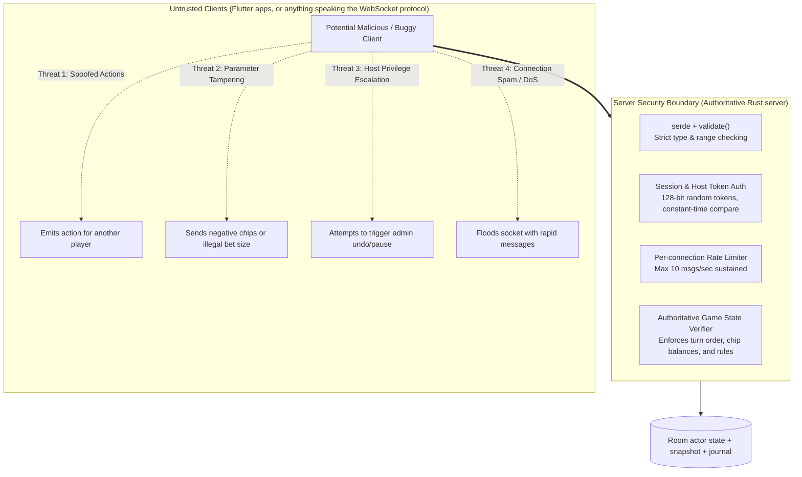
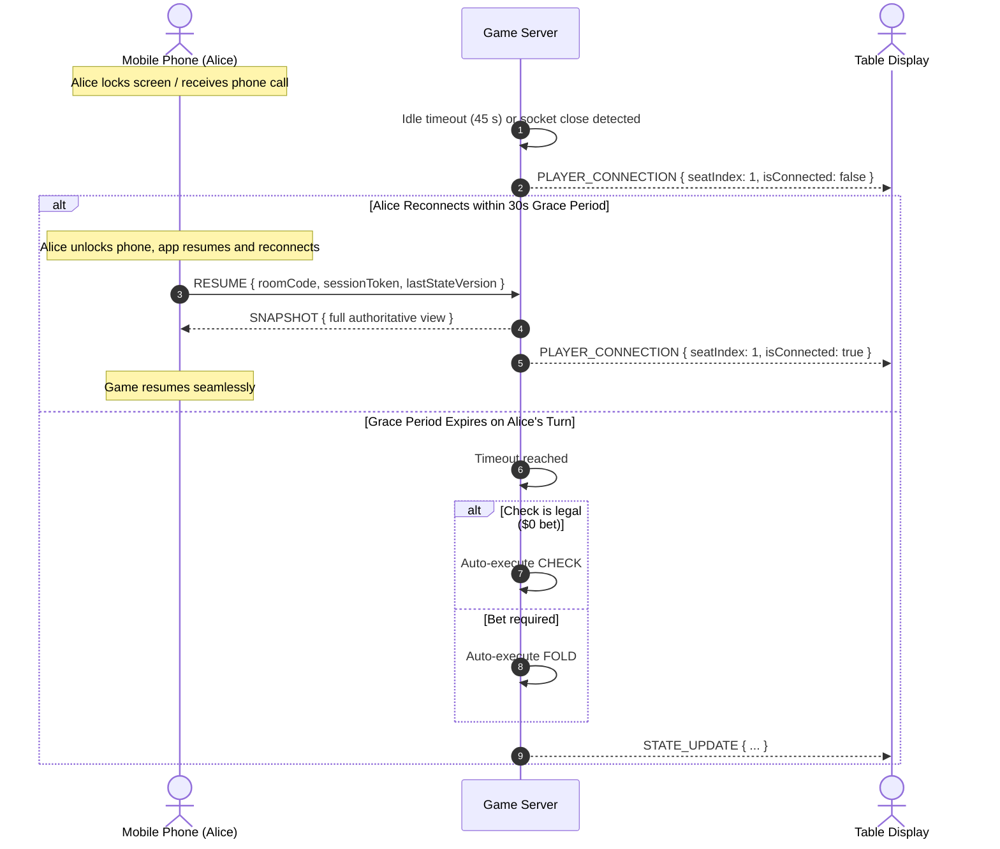
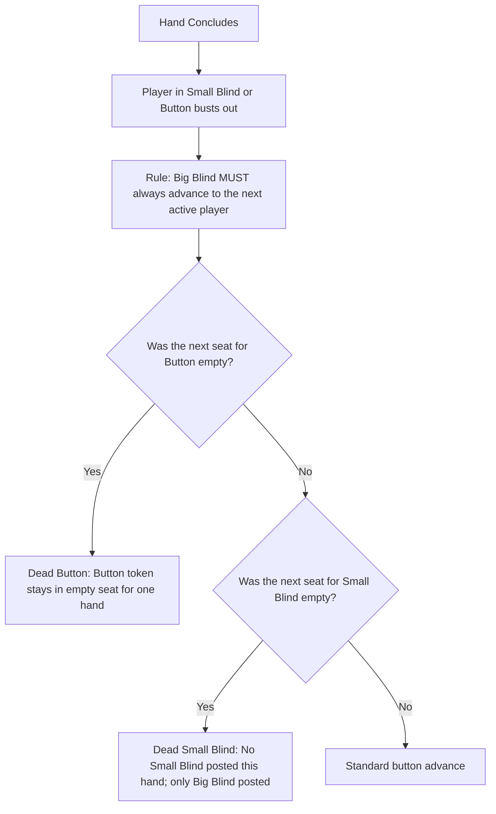
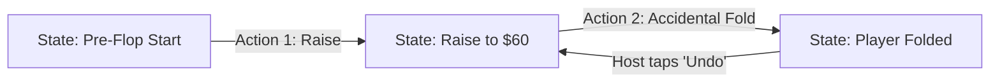

# Security & Edge Cases Specification: Poker Credits

## 1. Threat Model & Security Architecture

Even in home games, a digital companion app managing financial credits and pot distributions must be cryptographically sound, resilient to network disruption, and immune to client-side manipulation.



---

## 2. Core Security Controls

### 2.1. Authoritative Server Enforcement (Zero-Trust Client)
* **Clients are purely presentation displays**: The client never computes its own chip deductions or decides if a bet was successful.
* **Strict State Verification**:
  * The server checks:
    1. Is the incoming socket authenticated to the seat making the claim?
    2. Is it currently that seat's turn to act?
    3. Is the action legal on this street (e.g., cannot check if high bet > player's contribution)?
    4. Does the player have sufficient chips in their stack?
    5. Is the raise amount at least the required minimum raise?

### 2.2. Session Authentication & Impersonation Prevention
To prevent one player or spectator from spoofing actions for another player:
* Upon joining a room, the server issues a random 128-bit `sessionToken` from the OS RNG (`getrandom`). The server stores only a SHA-256 hash of it (in memory and in snapshots); comparison is constant-time (`subtle`).
```rust
pub struct PlayerSession {
    pub token_hash: [u8; 32],   // never the raw token
    pub player_id: PlayerId,    // public id
    pub room_code: RoomCode,
    pub seat_index: Option<SeatIndex>,
    pub role: Role,             // Host | Player | Spectator
    pub next_action_seq: u64,   // monotonic per session, advances only on applied actions
}
```
* The client keeps the raw token in **platform secure storage** (Keychain, Keystore, DPAPI/libsecret via a secure-storage plugin), not in plain preferences. If secure storage is unavailable the token is held in memory only and a restart requires re-joining.
* The first message on a connection must be `CREATE_ROOM`, `JOIN_ROOM` or `RESUME` (`NOT_AUTHENTICATED` otherwise). After that, the connection is bound to exactly one `playerId`; any message that names another player is rejected with `HOST_ONLY_ACTION` or `INVALID_SESSION` as appropriate. The server derives the acting player from the connection, never from a field in the message.

### 2.3. Host Privilege Protection
* Administrative functions (e.g. `UNDO`, `PAUSE`, `APPROVE_REBUY`, `ROOM_CONFIGURE`) require a dedicated `hostToken`.
* The `hostToken` is generated when the room is created and stored by the host app in secure storage (and, hashed, by the server).
* If a host disconnects, host status can only be reclaimed using this secret key.

### 2.4. Input Validation
* Player names, room codes and any free text are validated in the server's `validate()` step:
```rust
pub fn validate_name(raw: &str) -> Result<String, ErrorCode> {
    let n = raw.trim();
    let ok_len = (1..=20).contains(&n.chars().count());
    let ok_chars = n.chars().all(|c| c.is_ascii_alphanumeric() || c == ' ' || c == '_' || c == '-');
    if ok_len && ok_chars { Ok(n.to_owned()) } else { Err(ErrorCode::NameInvalid) }
}
```
* Flutter `Text` widgets do not interpret markup, so there is no XSS class of bug in the native app. Names are still restricted to a safe charset so they cannot break logs or a future web guest page.
* Maximum frame size 16 KiB; larger frames close the connection.

### 2.5. Rate Limiting & Denial-of-Service (DoS) Mitigation
* **Connection Throttling**: 10 messages per second sustained (burst 20) per connection; 3 strikes closes it. Per-IP connection cap and hourly counter reset follow LocalSend's signaling server (see `RESILIENCE_AND_CRASH_HANDLING.md` 3.6).
* **Action Idempotency**: Prevents rapid double-clicking (e.g. tapping "Raise" twice rapidly) using the per-player `actionSeq` counter (rules in `API_AND_EVENTS.md` 5.3). Duplicates are acknowledged and ignored.

---

## 3. Real-Time & Network Edge Cases



### 3.1. Mobile Screen Sleep & Backgrounding
* **Symptom**: iOS and Android suspend the app and its sockets when the screen locks or the user switches apps. A host app can also be killed outright.
* **Resolution (player side)**:
  1. **Disconnection Grace Timer**: If it is the disconnected player's turn, a 30-second timer runs (the room actor's deadline, no extra task).
  2. **Auto-Action on Expiry**: free check means **Auto-Check**; an outstanding bet means **Auto-Fold**.
  3. **Instant Resync**: on app `resumed` the client reconnects immediately and sends `RESUME`; the server answers with a full `SNAPSHOT`.
* **Resolution (host side)**: Android runs a foreground service while hosting; all platforms hold a wake-lock; iOS hosting is best-effort in the foreground. On `resumed` the host app probes its own listener and restarts it if dead; if the whole app was killed, the room is restored from snapshot + journal at next launch (`RESILIENCE_AND_CRASH_HANDLING.md` 3.4). Players see "Reconnecting" and rejoin the same hand.

### 3.2. Action Race Conditions (Concurrent Submissions)
* **Symptom**: Player A taps "Check" at the exact moment Player B taps "Raise".
* **Resolution**:
  * Each room is a single actor task with one inbox. Messages and the turn timer are handled strictly one at a time, in arrival order.
  * If Player B's raise is processed first, Player A's "Check" fails validation (`INVALID_CHECK`) and the error carries the updated call amount, prompting Call or Fold.

---

## 4. Poker Domain Edge Cases & Rules

### 4.1. The Dead Button & Missing Blinds Rule
When players bust out or leave the table, the blind positions can become distorted:



* **Core Invariant**: No player may ever be forced to pay the Big Blind twice in a row, nor may a player skip paying their Big Blind.
* **Dead Small Blind**: If the player due to pay the small blind just busted, only the Big Blind is posted.

### 4.2. Short All-In & The Betting Reopen Rule
In Texas Hold'em, an All-In bet that is smaller than the minimum legal raise is an **incomplete raise**:
* **Scenario**:
  * Big Blind is **$20**.
  * Player 1 bets **$100**.
  * Player 2 goes All-In for **$130** (an increase of only $30; minimum raise required was $100 + $80 = $180).
  * Player 3 Calls **$130**.
* **Rule**:
  * Because Player 2's raise was incomplete (< full raise), **betting is NOT reopened** for Player 1.
  * Player 1 may only **Call** the remaining $30 or **Fold**; Player 1 is **NOT allowed to re-raise**.
  * Betting would only reopen for Player 1 if Player 3 had made a full legal raise (e.g. to $210+).

### 4.3. Micro-Stack Sub-Blind All-Ins
* **Scenario**: Player has only **$6** remaining when it is their turn to post the **$20 Big Blind**.
* **Engine Handling**:
  * Player is automatically marked **All-In for $6**.
  * The Big Blind posted for the street is $20 (satisfied by the next largest contributor or treated as the benchmark).
  * The player with $6 is only eligible to win up to $6 from each opponent; the remaining $14 from each caller forms a separate pot tier.

### 4.4. Simultaneous Knockouts (Tournament Mode)
* If two or more players are eliminated in the exact same hand:
  * The player who entered the hand with **more chips** is awarded the higher finishing rank.
  * If they entered the hand with identical chip counts, they tie for the rank.

### 4.5. Dynamic Heads-Up Transition
* When a 3-handed table drops to 2 players:
  * The engine immediately detects `activePlayerCount === 2`.
  * Automatically switches to **Heads-Up rules**: Dealer Button posts the Small Blind and acts first pre-flop.

---

## 5. State Rollback & Undo Architecture (Host Misclick Recovery)

In home poker games, players frequently misclick (e.g. accidentally clicking "Fold" when they intended to "Call", or typing an extra 0 into a raise). 

To prevent ruining a hand, the engine implements an **Immutable State Stack**:



* **Snapshot History**: Before every action transition, the previous `GameState` is pushed onto the room's undo stack (`Vec<GameState>`, max 5).
* **Undo Trigger**: When the host sends `UNDO`:
  1. The server pops the current state and restores the previous state snapshot.
  2. The restored state is immediately broadcast to all connected devices.
  3. Action ticker logs: *"Host reverted last action"*.
  4. The journal records an `UNDO` entry so replay after a crash produces the same state.
* **Limit**: The undo stack retains the last 5 actions within the active hand and resets when a new hand begins.

---

## 6. Additional Security Controls (Originally Missing)

> [!IMPORTANT]
> The following security controls were **absent from the original documentation** and are required before production deployment:

### 6.1. Origin and Transport Policy
* The native app is not a browser, so CORS does not apply. In **both** cloud and host mode the WebSocket upgrade checks the `Origin` header **if present** (implemented 2026-11-03, `net/guards.rs::origin_allowed`): a browser origin is refused with 403 unless it is listed in `POKER_ALLOWED_ORIGINS` or is **same-origin with an address host**, meaning the `Origin` authority equals the `Host` header **and** that host is an IP literal or `localhost`. Requests without `Origin` (the native app) pass. This blocks malicious web pages from opening sockets to a LAN host from a user's browser (cross-site WebSocket hijacking against `ws://192.168.x.x`).
* "Origin equals Host" is **not** trusted for named hosts: `Host` is chosen by whoever opened the page, so under DNS rebinding a hostile `evil.example` that resolves to the server would look same-origin (found by the automated security review of the first version of this check). A server reached by name, such as a future web player, must list its own origin in `POKER_ALLOWED_ORIGINS`.
* Cloud mode requires `wss://` (TLS terminated by the host platform or a reverse proxy).
* Host (LAN) mode serves **TLS 1.3 only** with a per-phone self-signed certificate that guests pin (ADR-019); see 6.4. A host server refuses to listen on a non-loopback address without TLS, and the app refuses plain `ws://` to any address that is not loopback.
* **Host-header check (DNS rebinding):** in host mode a request is answered only when its `Host` is an IP literal, `localhost` or a `*.local` name (400 otherwise, `net/guards.rs::host_header_allowed`, applied as a middleware to every route). A page on the web cannot reach a LAN host through a name it controls. Cloud mode serves its own public name and is not subject to it.

### 6.2. Room TTL & Server-Side Garbage Collection
* **Problem**: If all players disconnect without formally ending a game, the room's state object remains in server memory indefinitely, causing a memory leak in long-running servers.
* **Solution**: Each room has a `lastActivityAt` timestamp. A `tokio::time::interval` task runs every 5 minutes and purges any room that has had no activity for **60 minutes**.
* Upon purge, all connected sockets in that room receive `ROOM_EXPIRED` so clients can show a graceful "Session Ended" screen. Snapshot and journal files for the room are deleted.

### 6.3. Maximum Room Size Enforcement
* Hard limit of **10 players** per room, enforced in the `JOIN_ROOM` handler.
* Spectators (read-only, no seat) are counted separately and capped at **20 spectators** per room.

### 6.4. LAN Mode Security Considerations
In **LAN mode** the server binds to `0.0.0.0` and every guest connection is encrypted and authenticated by a pinned certificate (ADR-019):
* **Encryption.** TLS 1.3 only, `rustls` with `ring`, ALPN `http/1.1`. Session tokens, host tokens, names and every game message travel inside TLS. Tested with a recording relay: the tokens appear on the wire only in the plaintext control run (`tests/tls.rs`).
* **Host identity.** Each phone has one self-signed ECDSA P-256 certificate, stored in the app data directory (`tls-identity.bin`, mode 0600, atomic write). Its SHA-256 fingerprint (43 characters base64url) is the pin. The system trust store is not consulted.
* **Where the pin comes from.** The QR code carries it (`f=`): a guest who scans the QR is pinned to that exact phone from the first packet. A guest who joins by room code, lobby list or typed address gets **trust on first use**: the app reads the certificate the answering device presents, pins to it, and stores the pin with the session so every reconnect and re-discovery must present the same certificate (`connection_provider.dart` refuses a device with a different one). An attacker who is already on the Wi-Fi and answers the very first probe can still be pinned; the QR code is the defence, and the Guide and the Terms say so.
* **What a failed check does.** A different certificate is `PinMismatch`: no retry, the stored tokens are kept, and the player is told the device is not the host they meant. A host that only speaks plain HTTP is `NoSecureChannel` ("older version" after two tries). Neither downgrades.
* **No plaintext on the network, by construction.** Host mode refuses to listen on a non-loopback address without TLS. Solo games use a `loopback_only` plain socket on `127.0.0.1`; see F6 in `SECURITY_AUDIT_2026-11-08.md` for the accepted risk of other apps on the same phone.
* **Hostile peers.** A peer that opens a socket and never speaks is cut after 5 s; at most 64 handshakes run at once and 8 per IP, so a flood of silent sockets cannot starve real guests. Accept and handshake are separate tasks.
* **Still true on any shared network:** the room code is the key to a lobby; a device on the same Wi-Fi can see an open lobby (6.6), try to join, or flood the port. The app tells players to host on their own Wi-Fi or hotspot, never on a public network, and to give the code only to people at the table.
* The same application-layer controls (session tokens, message validation, turn verification) apply in LAN mode.
* Never expose the LAN server port to a public-facing network interface.

### 6.5. Sensitive State Isolation (Player Hand Privacy)
* The `STATE_UPDATE` broadcast sent to **all** room members must **never** include private player hole cards.
* In physical-card rooms there are no cards in the system. In **virtual-card rooms (ADR-016)** each player's two cards are sent only in a `HOLE_CARDS` message addressed to that player's live connection (modelled on `TURN_PROMPT`), re-sent after every `SNAPSHOT`, and never to spectators. The public `RoomView` is built in `room/view.rs` from the revealed board and, after a showdown, the revealed hands only; it never reads the dealt hole cards.
* The table host display receives only public information: chip counts, bets, actions, pot totals, and (virtual rooms) the revealed board and showdown hands.

#### 6.5.1 Virtual cards: leak surfaces and controls
Full list in `docs/superpowers/specs/2026-11-07-virtual-cards-design.md` section 9. Summary:
* **Logs and panics:** `Deal`, `Card` and the deal-carrying `Op` have redacted `Debug`; no `tracing` of whole `Op` or `RoomState`. `tool/check_no_state_logging.sh` (CI and the pre-commit hook; `--self-test` proves it still bites) fails on a tracing macro that formats state, an op, a message, a view or cards with `?` or `%`. `cards_secrecy` formats the state and fails if a card token appears.
* **Disk:** the snapshot and journal contain the current hand's deal (needed for exact restore). Files are created `0600`, the data folder `0700` on Unix (`store/private.rs`; a test checks the modes).
* **Manual showdown lock:** `BEGIN_SHOWDOWN` and `RESOLVE_SHOWDOWN` from a host are `ILLEGAL_STATE` in virtual rooms, so a modified host client cannot award pots. The showdown is `Op::AutoShowdown`, created only by the room actor with engine-computed winners; no client message maps to it.
* **Undo:** limited to the current street so nobody can re-bet after seeing a card.
* **Hostile shapes:** `RevealView` carries the player id, name, two cards, category and best five of a hand that is being shown, and nothing else: no seat index and no card of a player who has not been revealed. `StartHand` has no deck field on the wire, so a client cannot choose the deal. `HOLE_CARDS` is `Broadcast::To(player)` only.
* **Old clients:** a virtual room refuses a client without `features: ["VIRTUAL_CARDS"]` (`UPDATE_REQUIRED`), so an old app never sits at a table it cannot play.
* **Fair shuffle:** OS entropy, unbiased Fisher-Yates, journaled as an input.
* **No-leak oracle test (`cards_leak`):** audits every view and every message of 40 seeded games per connection and fails if any other player's card appears before its reveal; a planted leak must be caught. `fuzz` runs a hostile client against a virtual victim and fails if it ever hears one of the victim's hole cards.
* **Accepted limit:** in host (LAN) mode the host's device runs the server and could be modified to read the deck. Documented to users; cloud mode removes it.

### 6.6. Room Code Guessing
Room codes have 32^4 (about 1.05 million) values. In cloud mode:
* `GET /v1/room/{code}` is rate limited per IP (2 per second, burst 10). On a cloud server a lookup of a code that does not exist also counts as a failed join (same budget and block as over the WebSocket); a LAN host does not count lookups. Failed `JOIN_ROOM` and `RESUME` attempts are counted per IP across connections (default 20 per minute, then a 15 minute block), so reconnecting does not reset the budget. `CREATE_ROOM` is limited to 6 per minute per IP so one client cannot fill `max_rooms`. Implemented in `net/guards.rs` and `net/ws.rs`.
* All per-IP limits (connections, lookups, creates, failures) are keyed by `limiter_key`: global unicast IPv6 addresses (`2000::/3`) are reduced to their `/64` prefix and IPv4-mapped IPv6 addresses to the IPv4 address, because one IPv6 customer owns billions of addresses. Loopback, link-local and unique-local addresses stay exact so phones on one LAN or hotspot do not share a budget in host mode. These ranges cannot reach a cloud server from the internet, so keeping them exact opens no rotation hole there; a hostile peer already on the LAN is outside this threat model. A two-tier scheme (per-address plus a looser per-`/64` cap) was considered and not built. A coarser `/48` limit and a global failure budget are not implemented (they would need config; open question).
* Known limit: behind a reverse proxy all clients share the proxy's address, so these per-IP limits then apply to everybody at once. Reading `X-Forwarded-For` behind a trusted proxy is not implemented; decide before deploying the cloud binary behind one. Attackers with many addresses can still probe slowly; 4 characters is the real limit (see the open owner question about longer codes).
* Joining still requires the host to seat the player or the room to have open seats; the host can enable "approve joins" (Phase 5 option).
* Idle rooms expire after 60 minutes.
In host (LAN) mode players find the host by code (ADR-012): the app probes `GET /v1/room/{code}` on every other address of its /24 networks. Properties and limits:
* A probe by code only ever reveals whether the asked code exists, plus counts that are already public to the asker; the existing per-IP HTTP and wrong-code limiters apply to probing hosts.
* **Open lobbies are listed on purpose (join screen, "Games on this Wi-Fi").** `GET /v1/lobbies` on a *host* server returns the room code, host name and seat count of rooms still in their lobby with a free seat; a *cloud* server answers an empty list always. So anybody on the same Wi-Fi can see the code of a game that has not started and join it: that is the feature, and it is the same audience that could already scan the /24 and guess the code (32^4, rate limited). Once the first hand is dealt, or the table is full, the game disappears from the list, and joining a running game still needs the code. Known limit: a host on a public Wi-Fi (café, hotel) shows its open lobby to strangers; a per-room "private game" switch is the follow-up if that matters (the host-side start flow would need a new bridge field).
* The probe itself is HTTPS (the app does not verify the probed device, it only reads its certificate fingerprint; nothing secret is sent). A rogue device on the LAN that answers `exists: true` for every code can capture the code asked for and the player's chosen name, and on a **first** join by code can be the device the guest pins to (trust on first use, 6.4); the QR code avoids this. **Re-discovery is different from a first join:** the stored session carries the host's pin, and `rediscover` refuses any device that presents a different certificate, so after a lost connection a rogue responder never receives the `RESUME` and its session token (ADR-019; before it, every `RESUME` crossed the LAN in cleartext). The QR code and the typed address avoid the search entirely.
* Search is cancellable, bounded (48 concurrent probes, 700 ms per probe, 12 s overall), accepts only HTTP 200 with a JSON body under 2 KiB and ignores everything else.
* Re-discovery after a lost connection only changes the address; the room and the session token are still checked by the server, and a wrong host just refuses the `RESUME`. The stored session is rewritten with the new address only after a host answered for that exact code.

### 6.7. Data at Rest and Crash Behaviour
* Snapshots and journals contain names, chip counts and **token hashes only**, never raw tokens or hostTokens. They live in the app support directory (host mode, app-private storage on mobile) or `POKER_DATA_DIR` (cloud).
* A panic in one room never exposes or corrupts another room: room actors share no mutable state. Recovery policy: `RESILIENCE_AND_CRASH_HANDLING.md` 3.3.
* The server never logs raw tokens, only the last 4 hex characters of a hash.

## 7. Bots and fairness (ADR-018, built)

- A bot decides from a per-seat `BotView` only; it cannot see `RoomState`, the deck, undealt cards or other hands. `poker_bots` does not depend on the server crate. Tests: `bot_view_invariance` (decision unchanged when hidden cards change) and `bot_view_has_no_foreign_cards`; the existing `cards_secrecy` and `cards_leak` tests must pass with bots seated.
- Bots are dealt from the same unbiased shuffle; no rigging for or against the human; `no_seat_advantage` and skill-ordering simulation tests guard it.
- A solo game binds the embedded server to `127.0.0.1` only: no LAN listener, no discovery, no lobby entry. Solo rooms are rejected from network `CREATE_ROOM` and can only be made through the host path on a `ServerConfig::loopback_only` server; `is_bot` is never sent to a client.
- Bot logs must not contain cards (`tool/check_no_state_logging.sh`).
- Edge cases: every bot decision is checked against the engine's legal actions; failure falls back to check or fold so a hand cannot stall; bots are exempt from absence, presence and vote-kick; the app pausing in the background pauses the bots.

## 8. Network, device and host events: what the app does (ADR-019, tested 2026-11-08)

The end-to-end suite (`app/test/e2e/lan_e2e_test.dart`) runs the real stack headless: the real Rust server through the native library, the real TLS sockets (also through this machine's own LAN address, not only loopback), the real host finder, and the app's own providers, one container per phone. Only what needs a screen is replaced (wake lock, haptics, sound, secure storage). Run it with `cargo build -p rust_lib_poker_bridge` and then, in `app`, `POKER_BRIDGE_LIB=$PWD/../target/debug/librust_lib_poker_bridge.so fvm flutter test test/e2e`. Without the variable the tests skip.

| Event | What the app does | Evidence |
| :--- | :--- | :--- |
| Guest's Wi-Fi drops and returns | Backoff retry, then `RESUME` with the same pin: same seat, no duplicate | e2e "a guest whose socket drops comes back to the same seat" |
| Guest taps Join twice | One seat | e2e "tapping Join twice makes one seat" |
| Guest cancels while the host is being looked at | Nothing is connected, no stored session | e2e "cancelling while the host is being looked at"; `join_probe_test` |
| Slow Wi-Fi: first certificate look fails | Asked once more after 300 ms, then joins | e2e "a slow first look"; `join_probe_test` |
| Room code nobody hosts | "Room not found", no hang | e2e "a room code nobody hosts" |
| Host app killed and reopened | Same certificate (identity file), guests resume their seats | e2e "the host app is killed and reopened" |
| Host app killed with a guest's app killed too | Guest's stored session resumes the same seat | e2e "a guest whose app was killed and reopened" |
| Host switches apps and the OS stops the server | On return the server restarts on the same port with the same pin | e2e "the host switches apps and the server is gone" |
| Host identity file lost | New pin: the guest stops with "not the host you meant", keeps its seat data, does not loop. Scanning the QR code again pins the new one | e2e "the host comes back with a new certificate" |
| Identity file corrupt, empty or oversized | Replaced and logged; read is capped at 16 KiB | `tls.rs` unit tests (1 MiB damaged file) |
| Port 7878 taken | Host uses 7879; a guest finds it by room code | e2e "port 7878 is taken" |
| Both usual ports taken | The OS gives another port; the QR code carries it | e2e "both usual ports are taken" |
| Host moves to another port (a stray listener took the old one) | After three failed tries the guest searches for the room code, accepts only the same certificate, and resumes on the new port. A failed handshake on a known host is a network error, never "outdated" | e2e "the host comes back on another port"; `socket_client_test` "a session that is being resumed keeps retrying" |
| Another device with another certificate answers the room code | Ignored; the session token is never sent to it | `connection_provider` rediscovery check; e2e "wrong fingerprint" |
| QR code with the wrong fingerprint | Refused before any message is sent; tokens kept; no retries | e2e "a QR code with the wrong fingerprint"; `secure_channel_test` |
| Host of an older version (plain HTTP) | One look at `/health` over HTTP; "host runs an older version" at once, nothing connected, no endless retry | e2e "a plain-HTTP host"; `host_finder_test`; `join_probe_test` |
| Plain `ws://` to another device, stored or typed | Refused for good | `socket_client_test`; `secure_channel_test` |
| Host ends the game | Guests are told and stop trying; their stored session is cleared | e2e "the host ends the game" |
| Host's data folder unwritable | Clear "storage" failure on the host screen, no crash | e2e "a folder the app cannot write to" |
| Silent socket (no bytes) | Dropped after 2 s | `tls.rs` integration test |
| Handshake started and never finished | Dropped after 5 s | `tls.rs` integration test |
| Handshake finished, then nothing | Closed after 1.25 times the WebSocket idle timeout; a live WebSocket with pings is not cut | `tls.rs` integration tests |
| Half an HTTP request that never ends (slowloris) | Closed by the same idle timer | `tls.rs` integration test |
| Garbage after a good handshake | Closed, short answer at most; the next guest is served | `tls.rs` integration test |
| Flood of handshakes from one address | At most 8 at once per address (IPv6 per /64) and 64 in all; the oldest of the heaviest address is dropped for a newcomer holding less, so one address cannot lock out a real guest | `tls.rs` unit and integration tests |
| Many established connections from one address | Per-address cap, plus the listener cap of twice that plus four | `the_per_address_limits_still_see_the_guest_address` |
| Plaintext client to the TLS port | No HTTP answer, no leak of a token (a sniffer sees tokens only without TLS) | `tls.rs` integration tests |
| Browser page on the same Wi-Fi reaches a host through its own name | `Host` header must be an IP literal, `localhost` or `*.local`, else 400 | e2e on the LAN address; `tls.rs` |
| Host's own screen after a guest connects or drops | The host's table shows the guest online or offline at once (`PLAYER_CONNECTION` is applied to the seat; it used to stay on the first value) | e2e "the host sees a guest go offline when the guest leaves the app, and come back"; `room_state_test` "who is connected" |
| Host disappears while a guest plays (process killed) | The guest shows RECONNECTING, the action buttons go grey, Leave stays usable; a new host with a new certificate at the same address is refused with "not the host you joined" | Android emulator, 2026-11-08 |
| Field validation message | Goes away as soon as the field is fixed (Join, Host, Play alone, name step) | `field_errors_test`, `name_step_test` |
| On-screen keyboard opens | The page keeps its layout and the tapped field keeps its focus | `keyboard_focus_test`; Android emulator |
| QR code too dense to scan | Asserted: version 5 at most (37 squares), at least 2.5 logical pixels per square on every table size | `qr_scan_budget_test` |

### Run on an Android emulator (2026-11-08), what stays device-only

An Android 17 emulator (Medium_Phone, x86_64, windowed) was used with this machine as the other player (the emulator reaches it as 10.0.2.2, and `adb forward` lets the PC reach the emulator). Checked on the debug build: a fresh install through terms, intro, tour and the name step; hosting with the foreground service and the TLS server on 0.0.0.0:7878; a PC guest joining the emulator host by typed address and playing a hand (chips and the host's own presence correct); the emulator joining a PC host by room code over TLS and playing a hand to showdown (1010 / 990, 2000 in all); the host process vanishing mid hand (RECONNECTING, buttons off) and a new host at the same address with a new certificate being refused; a solo game against bots, sent to the background for 20 s and resumed (paused, then RESUME continues the same hand). Manual drivers: `app/test/e2e/emulator_host_test.dart` and `emulator_guest_test.dart` (skipped without `EMULATOR_HOST` / `EMULATOR_ROOM`, see their headers).

Limits of that setup: the emulator's network proxy sends probes for the other 10.0.2.x addresses out through this machine's real network and keeps half-open sockets, so a search by room code from the emulator sometimes found nothing while the host was up (the app shows "no game with that code found" and the address field; a second try or a restart of the emulator network works). Real Wi-Fi does not behave like that, but it is a reminder that the 700 ms probe is a tight budget on a congested network; the typed address and the nearby list are the fallbacks.

### Not testable here (stays on the release checklist)

Still only on real phones (`docs/RELEASE_CHECKLIST.md`): the camera scanning a real QR code, Android doze and background limits on real hardware (the foreground service keeps the host alive), Wi-Fi roaming and captive networks, a release (R8) build at run time, the Windows build of `ring` at run time, iOS local-network permission, and rendering on a real small phone (the no-scroll golden tests cover layout but not a real GPU).
